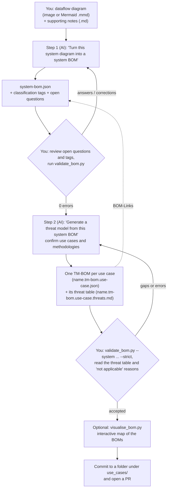
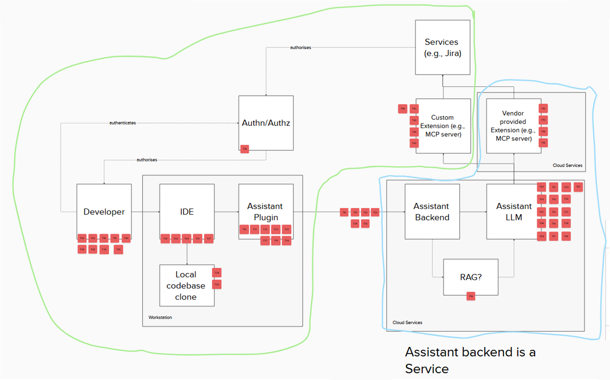
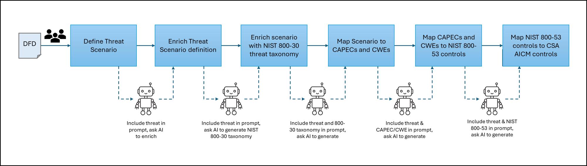
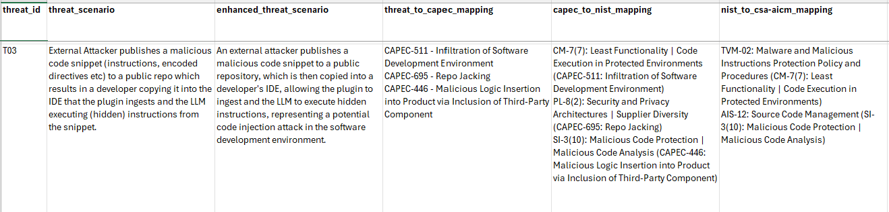

# Security and Compliance Work Group

## Use Cases and Threat Modeling Subgroup

> [!IMPORTANT]
> - The **Use Cases and Threat Modeling** subgroup meets weekly on Tuesdays @12pm US Eastern, 16:00 GMT.  Please use the calendar link below and click the "Need an invite?" link:
>     - [LF AI & Data calendar entry]( https://zoom-lfx.platform.linuxfoundation.org/meeting/93191199454?password=83a7bf08-2b26-44bc-aefd-8ad68b29c733)
>   - Slack: [#security-use-cases-and-threat-modeling](https://lfaifoundation.slack.com/archives/C09DHAQ399P)
>   - Meeting Agendas/Notes: [Google Doc](https://docs.google.com/document/d/1GzbzYeuvrXQIr9Uj6TiVXTrmnLPngOY7vuxc-CjOnas/edit?usp=drive_link)

### Leadership

##### Chairs:
  - Matt Colman ([IBM](https://www.ibm.com/))
    - mtcolman@uk.ibm.com
    - Slack: @Matt Colman
  - Petra Vukmirovoc ([Numan](https://www.numan.com/))
    - Slack: @petra vukmirovic

### Mission

To produce interoperable AI security and compliance standards through its lifecycle-wide use cases that with corresponding controls and risk mitigation measures informed by a library of real world threat models, make them directly consumable by automated security, compliance, and governance workflows.

### Goals

1. Identify and publish at least 3 pilot use cases + threat models in OWASP Threat Model Library
2. Align on the use case - threat model (threats, controls, risks) - standard workflow

### Guidance

#### Threat Statements

Threat statements need to be written with the following structure:

"Actor A ('the who') does B ('action') to C ('technical component') which results in doing D ('the reason') to E ('the resource')"

E.g.: "Attacker ('the who') tampers ('malicious action') with REST service parameters ('technical component') to view ('the reason') unauthorised customer data ('the resource')"

#### Threat Perspective

Threats need to be written with actors included within the diagram as the focal point, for example on a diagram that shows a developer flow, this threat:

> External Attacker publishes a malicious version of the official plugin to an unofficial marketplace which results in developers installing it and sending code to an attacker-controlled backend.

should be written as:

> Developer uses an unofficial marketplace and unknowingly installs a malicious version of the official plugin into the IDE. This results in code being sent to an external, attacker-controlled backend.

#### NIST 800-30 Taxonomy Alignment

The AI tool will enrich threat statements with NIST 800-30 rather than reformat them, e.g. we would send the following to the LLM when asking it to align CAPEC to the scenario:

> **Prompt**  
> Determine which CAPEC align(s) to this threat scenario 
> 
> Developer uses an unofficial marketplace and unknowingly installs a malicious version of the official plugin into the IDE. This results in code being sent to an external, attacker-controlled backend.

becomes:

> **Prompt**  
> Determine which CAPEC align(s) to this threat scenario, NIST 800-30 threat taxonomy alignment has been supplied to provide further clarity alongside the threat statement. Ensure to primarily focus on the details in the threat statement.
> 
> Developer uses an unofficial marketplace and unknowingly installs a malicious version of the official plugin into the IDE. This results in code being sent to an external, attacker-controlled backend.
> 
> NIST 800-30 taxonomy alignment:
>   - **Threat Source:** Adversarial - Individual - Insider
>   - **Threat Events:** Deliver/insert/install malicious capabilities - Insert tampered critical components into systems / Deliver/insert/install malicious capabilities - Insert targeted malware into organizational systems
>   - **Adverse Impacts:** HARM TO ASSETS - Loss of intellectual property / HARM TO ASSETS - Damage to or loss of information assets

### Process to follow

Human:
1. Create dataflow diagram
2. Generate threats (supply the guidance above for reference)
   - Ensure threats are written following the structure guidance above (amend any that aren't)
   - Ensure threats are written following the perspective guidance above (amend any that aren't)

AI:
1. Enrich human-generated threats with NIST 800-30 taxonomy (threat source, threat event, and adverse impact)
2. Map enriched statements to CAPEC & CWE
3. Map CAPEC & CWE to Controls (NIST 800-53 and CSA AICM)

### AI skills: CycloneDX 2.0 system BOMs and threat models

The repository includes AI assistant skills that automate the process above. They produce machine-readable [OWASP CycloneDX 2.0](https://cyclonedx.org/) documents, so that threat models can be consumed directly by security, compliance and governance tooling.

| Skill | Assistant | What it does |
|---|---|---|
| [`cyclonedx`](../../.bob/skills/cyclonedx/SKILL.md) | IBM Bob (`/cyclonedx`) | Turns a system diagram and notes into a **system BOM**, generates one **threat-model BOM (TM-BOM) per use case** from it, validates BOMs and the links between them, and maps where elements are declared and referenced. |
| [`claude-cyclonedx`](../../.claude/skills/claude-cyclonedx/SKILL.md) | Claude Code (`/claude-cyclonedx`, or ask in plain language) | The same skill for Claude Code. It is a thin entry point that uses the shared workflows, scripts, schema and examples in `.bob/skills/cyclonedx/`, so both assistants follow the same procedure and produce the same output. |
| [`purl`](../../.bob/skills/purl/SKILL.md) | IBM Bob | Package URL (ECMA-427) authoring, used for component identity in BOMs. |

The skills do the modelling; you supply the inputs, review what the assistant assumed, and run the validator to check its work.

- **System BOM:** a CycloneDX 2.0 description of the system: its components, actors, trust zones, boundaries, data flows and use cases.
- **TM-BOM:** the threat model for one use case. It carries a *slice* of the system BOM (the elements that use case touches), the threats, the NIST SP 800-30 enrichment, CAPEC and CWE mappings, NIST SP 800-53 and CSA AICM controls, and risks. It links back to the system BOM with BOM-Links.
- **Threat table:** a Markdown page generated from each TM-BOM for people to read and review. The TM-BOM stays the source of truth.

#### Process flow

| # | You provide | You run or ask | You get |
|---|---|---|---|
| 0 | A Python 3.9+ virtual environment (once) | `pip install -r .bob/skills/cyclonedx/scripts/requirements.txt` | The validator and scripts, ready to run |
| 1 | The dataflow diagram (a Mermaid `.mmd` or other text diagram gives better results than an image) and supporting notes: what each element is, its data, the use cases, and who hosts what | *"Turn this system diagram into a system BOM. Diagram: `<path>/diagram.mmd`. Notes: `<path>/notes.md`. Write it to `<path>/system-bom.json`."* ([workflow](../../.bob/skills/cyclonedx/workflows/diagram-to-system-bom.md)) | `system-bom.json`, a count of what was found, each component's classification tags (which decide what the threat sweep covers), and a list of open questions |
| 2 | Answers to the open questions | `python .bob/skills/cyclonedx/scripts/validate_bom.py <path>/system-bom.json` | Confirmation that the system BOM is valid. Fix mistakes here: they carry into every threat model |
| 3 | The validated system BOM | *"Generate a threat model from this system BOM: `<path>/system-bom.json`. Write one TM-BOM per use case into `<path>/`."* ([workflow](../../.bob/skills/cyclonedx/workflows/system-bom-to-threat-model.md)) | One TM-BOM per use case. For each, the assistant cuts the slice (`slice_use_case.py`), finds threats with STRIDE (and MAESTRO by default) on every element and flow, sweeps the applicable catalogues (OWASP Top 10s, MITRE ATLAS, MITRE ATT&CK, CWE) recording each item as a threat or "not applicable" with a reason, reviews the use case for system-specific threats, then adds NIST SP 800-30, CAPEC, CWE, NIST SP 800-53 and CSA AICM. Each TM-BOM also gets a Markdown threat table next to it (`tm_to_markdown.py`), in the shape of the [Code Assistant threat table](./use_cases/code_assistant/threats/code_assistant_threats.md) plus controls, risks and the "not applicable" decisions |
| 4 | Each TM-BOM | `python .bob/skills/cyclonedx/scripts/validate_bom.py <path>/<name>.tm-bom.<use-case>.json --system <path>/system-bom.json --strict --report-json <path>/<use-case>.coverage.json` | A coverage line (threats, elements covered, controls mapped, sweep decisions) and a JSON report of any gaps. 0 errors is required; with `--strict`, 0 warnings means full coverage |
| 5 | The system BOM and its TM-BOMs | `python .bob/skills/cyclonedx/scripts/visualise_bom.py bom <path>/system-bom.json <path>/*.tm-bom.*.json -o bom-map.html` | An offline, interactive HTML map of where each element is declared and referenced across the BOMs (keep it out of the repository) |

The validator proves that every decision was recorded, not that it is right. Read the threats and the "not applicable" reasons before sharing a threat model. In testing, a full threat model for a system with three use cases took the assistant about 1.5 to 2 hours.

To get started, follow [GETTING-STARTED.md](../../.bob/skills/cyclonedx/GETTING-STARTED.md) (setup for macOS, Linux and Windows, both steps, checking results, and troubleshooting). A worked example for the Code Assistant, a system BOM and a linked TM-BOM for Sub Use Case 1b, is in [`.bob/skills/cyclonedx/examples/`](../../.bob/skills/cyclonedx/examples/). Maintainer notes are in the [skills README](../../.bob/skills/README.md).

### Current Work

We have threat modelled the use case "AI Assistant Code Generator" (based on using a code-generating AI assistant as a plugin in IDE).

The DFD lives [here on Mural](https://app.mural.co/t/securityusecasesandthreatmod1795/m/securityusecasesandthreatmod1795/1761143364260/4f8be761b012f15453ff697a978bf113e9ac215c).

The Threat Model lives [here on google Docs](https://docs.google.com/spreadsheets/d/1SaB_a9iaSDTNvnyFJznMuBHIXmkDP1fcHX2ltcyJeUs/edit?usp=sharing) (please request access if needed). A copy is in the repository, as a Markdown table ([code_assistant_threats.md](./use_cases/code_assistant/threats/code_assistant_threats.md), columns A to K) and as the full spreadsheet, in [`use_cases/code_assistant/threats/`](./use_cases/code_assistant/threats/).

We are currently creating an automated, AI driven process to utilise AI to:

 - Enrich threat scenario text to ensure high quality
 - Enrich scenario with [NIST 800-30 threat taxonomy](https://nvlpubs.nist.gov/nistpubs/Legacy/SP/nistspecialpublication800-30r1.pdf)
 - Map threat scenario to [Common Attack Pattern Enumerations and Classifications (CAPEC)](https://capec.mitre.org/)
 - Map the CAPEC to [NIST SP800-53 Security and Privacy Controls for Information Systems and Organizations](https://csrc.nist.gov/projects/risk-management/sp800-53-controls/downloads) controls
 - Map NIST SP800-53 controls to [Cloud Security Alliance AI Controls Matrix (CSA AICM)](https://cloudsecurityalliance.org/artifacts/ai-controls-matrix) controls (where the threat is AI specific/focused)

**Note:** The way we define Threat Intent (as per NIST 800-30) is either: Intent by proxy _or_ Direct intent. So a Vendor can be adversarial even if it is by proxy through an attacker if they are compromised

This gives us the following mapping:

