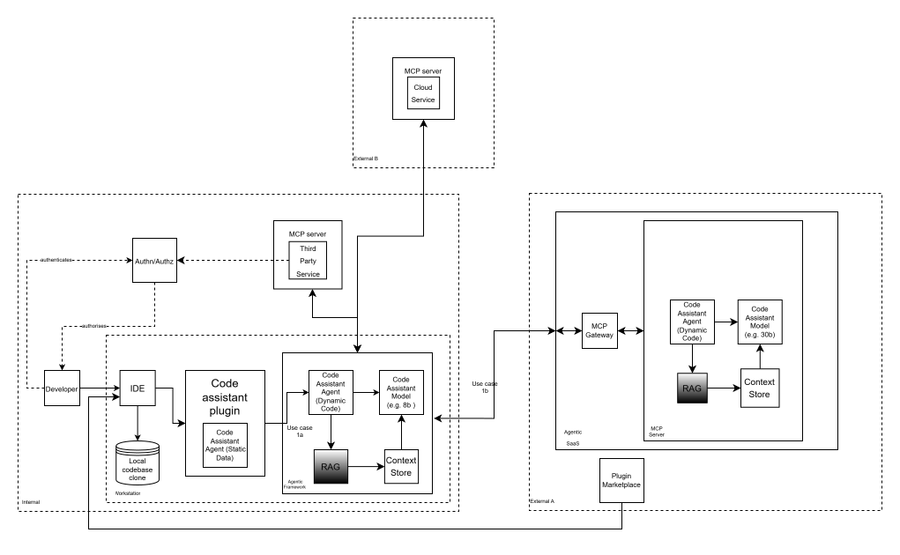

# Use Case: Code Assistant

This document provides concise definitions of the items used in threat modeling diagram.

Diagram (draw.io): 

[Edit this diagram (draw.io XML)](./diagram/ai_code_generator_threat_model_diagram_updated_2026_05_12.drawio)

## Diagram entity to CycloneDX `refId` mapping

Each entity in the diagram above is listed with its CycloneDX `refId`. Each `refId` links to the JSON fragment that defines it: the [`components` encoding](#cyclonedx-20--components-encoding) for components, and the [`actors` encoding](#cyclonedx-20--actors-encoding) for actors. Each type links to the prose definition of its taxonomy group. An entity that appears in both sub use cases is listed in both tables. Where an agent is both an actor and a component, both `refId` values are shown (see [Component ↔ Party ↔ Actor links](#cyclonedx-20--component--party--actor-links)).

Membership is taken from the `relationships` and `flows` of each sub use case, which are the canonical record. The tables are a navigation aid and the BOM remains the source of truth.

### Sub Use Case 1a — Local agentic framework

| Diagram entity                        | CycloneDX `refId`                                                                                                                                                                                  | Type                                                         | Zone           |
| ------------------------------------- | -------------------------------------------------------------------------------------------------------------------------------------------------------------------------------------------------- | ------------------------------------------------------------ | -------------- |
| Developer                             | [`actor:developer`](#cyclonedx-20--actors-encoding)                                                                                                                                                | [Actor](#actors-partiesroles)                                | Internal       |
| IDE                                   | [`component:local-ide`](#cyclonedx-20--components-encoding)                                                                                                                                        | [Application](#application)                                  | Internal       |
| Code Assistant Plugin                 | [`component:code-asst-plugin`](#cyclonedx-20--components-encoding)                                                                                                                                 | [Data](#data)                                                | Internal       |
| Code Assistant Agent (static)         | [`component:code-asst-agent`](#cyclonedx-20--components-encoding)                                                                                                                                  | [Application](#application)                                  | Internal       |
| Local Codebase Clone                  | [`component:data-local-codebase`](#cyclonedx-20--components-encoding)                                                                                                                              | [Data](#data)                                                | Internal       |
| Authentication Service                | [`component:authn-service`](#cyclonedx-20--components-encoding)                                                                                                                                    | [Application](#application)                                  | Internal       |
| Authorization Service                 | [`component:authz-service`](#cyclonedx-20--components-encoding)                                                                                                                                    | [Application](#application)                                  | Internal       |
| Third Party MCP Server                | [`component:mcp-server-third-party`](#cyclonedx-20--components-encoding)                                                                                                                           | [Application](#application)                                  | Internal       |
| Agentic Framework                     | [`component:internal-agentic-framework`](#cyclonedx-20--components-encoding)                                                                                                                       | [Framework](#framework)                                      | Internal       |
| Code Assistant Agent (local, dynamic) | [`actor:local-code-asst-agent`](#cyclonedx-20--actors-encoding), [`component:local-code-asst-agent`](#cyclonedx-20--components-encoding)                                                           | [Actor](#actors-partiesroles) / [Application](#application)  | Internal       |
| Local Code Assistant Model            | [`component:code-assistant-model-local`](#cyclonedx-20--components-encoding)                                                                                                                       | [Machine-Learning-Model](#machine-learning-model)            | Internal       |
| Local RAG                             | [`component:rag-local`](#cyclonedx-20--components-encoding)                                                                                                                                        | [Application](#application)                                  | Internal       |
| Local Context Store                   | [`component:context-store-local`](#cyclonedx-20--components-encoding)                                                                                                                              | [Data](#data)                                                | Internal       |
| MCP Server — Cloud Service            | [`component:mcp-cloud`](#cyclonedx-20--components-encoding)                                                                                                                                        | [Application](#application)                                  | External Cloud |
| Cloud Service                         | [`component:cloud-service`](#cyclonedx-20--components-encoding)                                                                                                                                    | [Application](#application)                                  | External Cloud |

### Sub Use Case 1b — External SaaS agentic framework

| Diagram entity                        | CycloneDX `refId`                                                                                                                                                                                  | Type                                                         | Zone           |
| ------------------------------------- | -------------------------------------------------------------------------------------------------------------------------------------------------------------------------------------------------- | ------------------------------------------------------------ | -------------- |
| Developer                             | [`actor:developer`](#cyclonedx-20--actors-encoding)                                                                                                                                                | [Actor](#actors-partiesroles)                                | Internal       |
| IDE                                   | [`component:local-ide`](#cyclonedx-20--components-encoding)                                                                                                                                        | [Application](#application)                                  | Internal       |
| Code Assistant Plugin                 | [`component:code-asst-plugin`](#cyclonedx-20--components-encoding)                                                                                                                                 | [Data](#data)                                                | Internal       |
| Code Assistant Agent (static)         | [`component:code-asst-agent`](#cyclonedx-20--components-encoding)                                                                                                                                  | [Application](#application)                                  | Internal       |
| Local Codebase Clone                  | [`component:data-local-codebase`](#cyclonedx-20--components-encoding)                                                                                                                              | [Data](#data)                                                | Internal       |
| Authentication Service                | [`component:authn-service`](#cyclonedx-20--components-encoding)                                                                                                                                    | [Application](#application)                                  | Internal       |
| Authorization Service                 | [`component:authz-service`](#cyclonedx-20--components-encoding)                                                                                                                                    | [Application](#application)                                  | Internal       |
| Third Party MCP Server                | [`component:mcp-server-third-party`](#cyclonedx-20--components-encoding)                                                                                                                           | [Application](#application)                                  | Internal       |
| External Plugin Marketplace           | [`component:external-plugin-marketplace`](#cyclonedx-20--components-encoding)                                                                                                                      | [Platform](#platform)                                        | External SaaS  |
| Agentic SaaS                          | [`component:agentic-saas`](#cyclonedx-20--components-encoding)                                                                                                                                     | [Platform](#platform)                                        | External SaaS  |
| Agentic Framework                     | [`component:external-saas-agentic-framework`](#cyclonedx-20--components-encoding)                                                                                                                  | [Framework](#framework)                                      | External SaaS  |
| MCP Gateway                           | [`component:mcp-gateway`](#cyclonedx-20--components-encoding)                                                                                                                                      | [Application](#application)                                  | External SaaS  |
| MCP Server — Agentic SaaS             | [`component:mcp-agentic-saas`](#cyclonedx-20--components-encoding)                                                                                                                                 | [Application](#application)                                  | External SaaS  |
| Remote Code Assistant Agent           | [`actor:remote-code-asst-agent`](#cyclonedx-20--actors-encoding), [`component:remote-code-asst-agent`](#cyclonedx-20--components-encoding)                                                         | [Actor](#actors-partiesroles) / [Application](#application)  | External SaaS  |
| Remote Code Assistant Model           | [`component:code-assistant-model-remote`](#cyclonedx-20--components-encoding)                                                                                                                      | [Machine-Learning-Model](#machine-learning-model)            | External SaaS  |
| Remote RAG                            | [`component:rag-remote`](#cyclonedx-20--components-encoding)                                                                                                                                       | [Application](#application)                                  | External SaaS  |
| Remote Context Store                  | [`component:context-store-remote`](#cyclonedx-20--components-encoding)                                                                                                                             | [Data](#data)                                                | External SaaS  |
| MCP Server — Cloud Service            | [`component:mcp-cloud`](#cyclonedx-20--components-encoding)                                                                                                                                        | [Application](#application)                                  | External Cloud |
| Cloud Service                         | [`component:cloud-service`](#cyclonedx-20--components-encoding)                                                                                                                                    | [Application](#application)                                  | External Cloud |

---

## Overview

The **Code Assistant** use case describes an AI-powered development assistant that is surfaced to a developer directly inside an Integrated Development Environment (IDE). The assistant is installed as a **model plugin** — a first-class IDE extension that embeds agent capabilities into the editing experience without requiring the developer to switch context to a separate application.

### Local agents (in-IDE runtime)

Once the plugin is installed, a **Code Assistant Agent** (local, dynamic) runs within the plugin process on the developer's workstation. Before installation it is treated as a static software component (the *Code Assistant Plugin*); once activated inside the IDE it becomes an actor with agency.
- When hardware permits, a locally quantized language model (e.g., an 8B parameter model) serves inference entirely on the workstation, keeping code and context within the local trust boundary.
- *Local* indicates that the agent and its agentic framework run entirely on the developer's workstation, within the internal trust boundary.
- *Dynamic* indicates that the agent can take autonomous actions — tool calling, invoking MCP servers, and orchestrating multi-step workflows — rather than merely responding to single-turn prompts. The agent handles the full range of tasks from low-latency inline completions through to complex, multi-step operations such as autonomous code generation, repository-wide refactoring, and test scaffolding.

### External connectivity

The plugin and its local agents reach outward through standardized agent protocols — primarily the **Model Context Protocol (MCP)** — to two categories of external endpoint:

1. **Large-model services.** When a task exceeds local model capacity, or when the deployment is configured to delegate the entire agentic framework to a hosted platform, the Code Assistant Agent connects to an **external SaaS agentic platform** via an MCP Gateway. The remote platform hosts a **Remote Code Assistant Agent** — an agent that is opaque to the developer and operates entirely within the External SaaS trust boundary — together with a larger or specialized language model, a remote RAG pipeline, and a remote context store. Results flow back through the MCP Gateway to the local plugin.

2. **Information and tooling services.** Agents can invoke any number of **MCP Servers** that expose capabilities as callable tools: internal enterprise services (code search, ticket systems, internal APIs), external cloud-provider APIs (infrastructure provisioning, container registries, secret managers), and data-retrieval endpoints. Each MCP Server acts as a controlled egress point, enforcing authentication, authorization, and audit logging before forwarding requests to the underlying service.

### Trust boundaries and deployment variants

Two named boundaries partition the architecture:

- **Internal boundary** — represents **locally networked resources**: the developer's workstation, the IDE, the Code Assistant Plugin and its embedded agent, the local agentic framework, and any MCP servers (e.g., a locally installed Jira MCP Server) that are reachable within the organization's local network. All components within this boundary are subject to the organization's own security controls.

- **External boundary** — represents **remotely networked services**: any service that is reached over the public internet or a remote network, including the Agentic SaaS platform (e.g., Claude Code, Cursor), the External Plugin Marketplace, and cloud-provider APIs. Components within this boundary operate under a third-party trust model; the organization has limited visibility into their internal behavior and data handling.

The architecture supports two primary deployment variants that share the same plugin surface but differ in where the agentic framework runs:

| Variant | Agentic framework | Model | Data residency |
|---------|------------------|-------|---------------|
| **Sub Use Case 1a** — Local, IDE Agent | Agentic Framework runs locally on the developer's workstation (within the **Internal** boundary) | Local (e.g., small, 8B parameter model) | Stays on-workstation; cloud calls only via explicit MCP |
| **Sub Use Case 1b** — Remote, SaaS Agent | Agentic Framework is hosted on a remote SaaS platform (within the **External** boundary), reached via MCP Gateway | Remote, hosted (e.g., large, 128B parameter model) | Leaves workstation via MCP Gateway to remote SaaS |

In both variants the developer's IDE remains the single point of interaction. Authentication and authorization services guard every outbound connection, and all agent tool invocations are intended to be logged and auditable regardless of where the agentic framework is hosted.

### CycloneDX 2.0 — `blueprint` identity

A `blueprint` is a top-level element of any CycloneDX BOM that wishes to include its design: the actors, zones, boundaries, flows, and use cases that describe how a system behaves. It appears inside a `blueprints` array at the root of the BOM. All design elements — `zones`, `boundaries`, `actors`, `flows`, `relationships`, and `useCases` — live *inside* the blueprint object rather than at the BOM root. There is no root-level `components` array in CycloneDX 2.0: components are declared as reusable entries in `definitions.components`, associated with the system by reference in `inventories`, and the blueprint refers to them by `refId`. Use case content is declared in `definitions.useCases`.

> **Complete BOM:** the JSON snippets in this document are fragments. The complete, schema-valid CycloneDX 2.0 BOM that assembles every fragment with all objects, elements and values is [`code_assistant_bom_2.0.json`](./code_assistant_bom_2.0.json).

```json
{
  "specFormat": "CycloneDX",
  "specVersion": "2.0",
  "version": 1,
  "definitions": {
    "components": [ "...defined in the components section below..." ],
    "useCases":   [ "...defined in the use-case sections below..." ]
  },
  "inventories": [ "...defined in the inventories section below..." ],
  "blueprints": [
    {
      "refId": "blueprint:code-assistant",
      "name": "Code Assistant",
      "description": "An AI-powered development assistant surfaced to a developer inside an IDE as a model plugin. The assistant embeds agent capabilities directly into the editing experience, supporting both a fully local deployment (Sub Use Case 1a) and a remote SaaS-hosted agentic framework (Sub Use Case 1b).",
      "modelTypes": [ "logical" ],
      "zones":         [ "...defined in the zones and boundaries section below..." ],
      "boundaries":    [ "...defined in the zones and boundaries section below..." ],
      "actors":        [ "...defined in the actors section below..." ],
      "flows":         [ "...defined in the flows sections below..." ],
      "relationships": [ "...defined in the relationships sections below..." ],
      "useCases":      [ "...references defined in the use-case sections below..." ]
    }
  ]
}
```

### CycloneDX 2.0 — `zones` and `boundaries`

In CycloneDX 2.0 a **zone** is a grouping of assets that share a security posture or administrative control, and a **boundary** is an *edge* between two or more zones where controls or trust levels change. The three trust groupings (Internal, External SaaS, External Cloud) are therefore modeled as three `zones` of `type: "trust"`, and the points where traffic crosses between them are modeled as `boundaries` that reference two zones each. A boundary requires at least two `zones`.

Members are attached to a zone with an `aggregates` relationship (see [Sub Use Case 1a relationships](#cyclonedx-20--sub-use-case-1a-relationships)).

> **Scope note:** zone-crossing requirements are not considered at this time. The schema lets a boundary carry `crossingRequirements` (authentication, authorization, protocols, data validation, logging, monitoring, rate limiting) and `sessionManagement`; the boundaries here intentionally omit them, so they record only *which* zones are connected, not the controls enforced at each crossing.

```json
{
  "refId": "blueprint:code-assistant",
  "zones": [
    {
      "refId": "zone:internal",
      "name": "Internal",
      "description": "Represents locally networked resources: the developer's workstation, the IDE, the Code Assistant Plugin and its embedded agent, the local agentic framework, and any MCP servers reachable within the organization's local network. All components within this boundary are subject to the organization's own security controls.",
      "type": "trust"
    },
    {
      "refId": "zone:external-saas",
      "name": "External SaaS",
      "description": "Represents remotely networked managed services: the Agentic SaaS platform (e.g., Claude Code, Cursor), the External Plugin Marketplace, and any third-party application services accessed over the public internet. Components within this boundary operate under a third-party trust model with limited organizational visibility.",
      "type": "trust"
    },
    {
      "refId": "zone:external-cloud",
      "name": "External Cloud",
      "description": "Represents remotely networked external services that the assistant reaches through an MCP Server interface. These services are characterized only by the MCP protocol and by being external, for example GitHub, Slack, or a database; the specific services are intentionally not scoped. Components within this zone are governed by the external service provider's own security and shared-responsibility model.",
      "type": "trust"
    }
  ],
  "boundaries": [
    {
      "refId": "boundary:internal-to-external-saas",
      "name": "Internal ↔ External SaaS",
      "type": "trust",
      "zones": [
        "zone:internal",
        "zone:external-saas"
      ]
    },
    {
      "refId": "boundary:internal-to-external-cloud",
      "name": "Internal ↔ External Cloud",
      "type": "trust",
      "zones": [
        "zone:internal",
        "zone:external-cloud"
      ]
    },
    {
      "refId": "boundary:external-saas-to-external-cloud",
      "name": "External SaaS ↔ External Cloud",
      "type": "trust",
      "zones": [
        "zone:external-saas",
        "zone:external-cloud"
      ]
    }
  ]
}
```

### CycloneDX 2.0 — top-level `definitions.useCases`

The top-level use case groups both sub use cases. In CycloneDX 2.0 a use case is declared once in the document-level `definitions.useCases` registry and carries its narrative content (preconditions, postconditions, exceptions, success criteria, notes). It does not list flows; the blueprint refers to the use case and lists the flows it traverses, see [Top-level blueprint `useCases` reference](#cyclonedx-20--top-level-blueprint-usecases-reference).

```json
{
  "definitions": {
    "useCases": [
      {
        "refId": "usecase:code-assistant",
        "name": "Code Assistant",
        "description": "A developer uses an AI-powered code assistant—composed of a plugin, one or more agents, a language model, a retrieval-augmented generation (RAG) pipeline, and an agentic framework—to accelerate software development tasks such as code generation, explanation, and review. The assistant may run fully on the developer's workstation (Sub Use Case 1a) or offload its agentic components to an external SaaS platform (Sub Use Case 1b).",
        "preconditions": [
          "Developer has an IDE installed and a local codebase clone available.",
          "The Code Assistant Plugin has been installed from a trusted, authenticated Plugin Marketplace (e.g., VS Code Marketplace, JetBrains Marketplace) whose publisher identity and plugin integrity are verified before delivery to the IDE.",
          "The installed Code Assistant Plugin is authenticated and authorized via the Authentication and Authorization Services.",
          "The MCP Server — Agentic SaaS (e.g., Claude Code, hosted remotely on the Agentic SaaS platform) is reachable from the developer's workstation.",
          "The locally installed MCP Server (e.g., a Jira MCP Server installed on the developer's workstation) is running and reachable."
        ],
        "postconditions": [
          "Developer receives AI-generated code suggestions, completions, or reviews.",
          "Any tool invocations performed by agents are logged and auditable.",
          "No sensitive code or credentials are unintentionally exfiltrated."
        ],
        "exceptions": [
          {
            "name": "Authentication Failure",
            "condition": "The Authentication Service rejects the Developer's credentials or token.",
            "description": "The developer cannot authenticate, preventing plugin activation.",
            "handling": "The plugin displays an authentication error; the developer is prompted to re-authenticate or contact an administrator."
          },
          {
            "name": "MCP Server Unreachable",
            "condition": "An internal or external MCP Server is unavailable or returns a connection error.",
            "description": "Tool calls from the agent cannot be completed, potentially stalling multi-step workflows.",
            "handling": "The agent reports the tool failure to the developer and falls back to model-only responses where possible."
          },
          {
            "name": "Prompt Injection Detected",
            "condition": "Malicious content in the codebase, context store, or RAG output attempts to redirect agent behavior.",
            "description": "An injected instruction overrides the developer's intent, potentially causing unauthorized tool invocations or data exfiltration.",
            "handling": "The agentic framework applies input sanitization; suspicious instructions are flagged and execution is halted pending developer review."
          }
        ],
        "successCriteria": [
          "Developer receives accurate, contextually relevant code suggestions or completions.",
          "All agent tool invocations are authorized and within the defined permission scope.",
          "No sensitive data (credentials, proprietary code) is transmitted to unauthorized endpoints.",
          "Audit logs capture all agent actions and external service calls."
        ],
        "notes": [
          "This top-level use case is realized by two sub use cases (1a and 1b) that differ in the deployment location of the Agentic Framework and its hosted components."
        ]
      }
    ]
  }
}
```

---

## Sub Use Case 1a

The developer's workstation hosts the full agentic framework, including the dynamic agent, model, RAG, and context store. The assistant plugin communicates directly with locally running components, with MCP servers bridging internal third-party services and external cloud platforms.

<!-- ```
Internal
├── MCP Server
│   └── Third Party Service
├── Authn/Authz
└── Workstation
    ├── IDE
    ├── Local Codebase Clone
    ├── Code Assistant Plugin
    │   └── Code Assistant Agent
    └── Agentic Framework
        ├── Code Assistant Agent (local, dynamic)
        ├── Code Assistant Model (e.g. 8b)
        ├── RAG
        └── Context Store

External Cloud
└── MCP Server
    └── Cloud Service
```-->

### CycloneDX 2.0 — Sub Use Case 1a relationships

The structural containment expressed in the ASCII diagram above, encoded using the blueprint `relationship` object. Each entry in `relationships` has a single subject (`ref`) and one typed relationship property whose value lists the targets.

Relationship semantics used:
- **`aggregates`** — the subject is the whole of a loose whole-part grouping (zone → top-level members that can exist independently of that zone).
- **`composes`** — the subject is the whole of a strong whole-part grouping (a component whose parts cannot meaningfully exist without it at runtime).
- **`contains`** — the subject directly nests or hosts the target (a component that wraps or embeds another).

```json
{
  "refId": "blueprint:code-assistant",
  "relationships": [
    {
      "ref": "zone:internal",
      "aggregates": [
        "component:mcp-server-third-party",
        "component:authn-service",
        "component:authz-service",
        "component:local-ide",
        "component:data-local-codebase",
        "component:code-asst-plugin",
        "component:internal-agentic-framework"
      ]
    },
    {
      "ref": "component:code-asst-plugin",
      "contains": [
        "component:code-asst-agent"
      ]
    },
    {
      "ref": "component:internal-agentic-framework",
      "composes": [
        "component:local-code-asst-agent",
        "component:code-assistant-model-local",
        "component:rag-local",
        "component:context-store-local"
      ]
    },
    {
      "ref": "zone:external-cloud",
      "aggregates": [
        "component:mcp-cloud"
      ]
    },
    {
      "ref": "component:mcp-cloud",
      "contains": [
        "component:cloud-service"
      ]
    }
  ]
}
```

### CycloneDX 2.0 — Sub Use Case 1a flows

The flows traversed by Sub Use Case 1a (fully local agentic framework). Five of these flows (`flow:developer-to-ide`, `flow:ide-to-plugin`, `flow:plugin-to-authn`, `flow:plugin-to-authz`, `flow:mcp-cloud-to-cloud-service`) are shared with Sub Use Case 1b and are defined once, in the blueprint's single `flows` array; both use cases reference them.

**Flow `refId` naming:** flows used by only one variant carry the variant label in their `refId` (`flow:1a:…` or `flow:1b:…`). Flows shared by both variants have no label (`flow:…`), since a single `refId` cannot name both. The complete set of 23 flows is in [`code_assistant_bom_2.0.json`](./code_assistant_bom_2.0.json).

```json
{
  "refId": "blueprint:code-assistant",
  "flows": [
    {
      "refId": "flow:developer-to-ide",
      "name": "Developer submits coding request",
      "description": "The Developer initiates a coding assistance interaction by submitting a request through the IDE.",
      "source": "actor:developer",
      "destination": "component:local-ide",
      "type": "control",
      "synchronous": true,
      "sequence": 1
    },
    {
      "refId": "flow:ide-to-plugin",
      "name": "IDE activates plugin",
      "description": "The IDE routes the developer's request to the Code Assistant Plugin.",
      "source": "component:local-ide",
      "destination": "component:code-asst-plugin",
      "type": "control",
      "synchronous": true,
      "sequence": 2
    },
    {
      "refId": "flow:plugin-to-authn",
      "name": "Plugin authenticates developer",
      "description": "The Code Assistant Agent sends credentials to the Authentication Service to verify developer identity.",
      "source": "component:code-asst-agent",
      "destination": "component:authn-service",
      "type": "control",
      "synchronous": true,
      "encrypted": true,
      "sequence": 3
    },
    {
      "refId": "flow:plugin-to-authz",
      "name": "Plugin checks developer permissions",
      "description": "The Code Assistant Agent queries the Authorization Service to verify developer permissions.",
      "source": "component:code-asst-agent",
      "destination": "component:authz-service",
      "type": "control",
      "synchronous": true,
      "encrypted": true,
      "sequence": 4
    },
    {
      "refId": "flow:1a:plugin-to-codebase",
      "name": "Local agent queries codebase",
      "description": "The Code Assistant Agent reads from the Local Codebase Clone to assemble context for the request.",
      "source": "component:code-asst-agent",
      "destination": "component:data-local-codebase",
      "type": "data",
      "synchronous": true,
      "sequence": 5
    },
    {
      "refId": "flow:1a:plugin-to-mcp-third-party",
      "name": "Local agent calls internal MCP Server",
      "description": "The Code Assistant Agent dispatches a tool call to the internally operated Third Party MCP Server (e.g., Jira MCP Server) to retrieve context such as tickets or project metadata.",
      "source": "component:code-asst-agent",
      "destination": "component:mcp-server-third-party",
      "type": "control",
      "synchronous": true,
      "sequence": 6
    },
    {
      "refId": "flow:1a:plugin-to-framework",
      "name": "Local agent delegates to local agentic framework",
      "description": "The Code Assistant Agent forwards complex or multi-step tasks to the local agent (local, dynamic) within the local Agentic Framework. Applies to Sub Use Case 1a only.",
      "source": "component:code-asst-agent",
      "destination": "component:internal-agentic-framework",
      "type": "control",
      "synchronous": true,
      "sequence": 7
    },
    {
      "refId": "flow:1a:dynamic-to-model-local",
      "name": "Local agent invokes local model",
      "description": "The local agent (local, dynamic) sends the enriched prompt to the Local Code Assistant Model for inference.",
      "source": "actor:local-code-asst-agent",
      "destination": "component:code-assistant-model-local",
      "type": "data",
      "synchronous": true,
      "sequence": 8
    },
    {
      "refId": "flow:1a:dynamic-to-rag-local",
      "name": "Local agent queries local RAG",
      "description": "The local agent (local, dynamic) retrieves augmented context from the Local RAG pipeline.",
      "source": "actor:local-code-asst-agent",
      "destination": "component:rag-local",
      "type": "data",
      "synchronous": true,
      "sequence": 9
    },
    {
      "refId": "flow:1a:dynamic-to-ctx-local",
      "name": "Local agent reads local context store",
      "description": "The local agent (local, dynamic) fetches structured context from the Local Context Store.",
      "source": "actor:local-code-asst-agent",
      "destination": "component:context-store-local",
      "type": "data",
      "synchronous": true,
      "sequence": 10
    },
    {
      "refId": "flow:1a:dynamic-to-mcp-cloud",
      "name": "Local agent calls cloud MCP Server",
      "description": "The local agent (local, dynamic) invokes the MCP Server — Cloud Service to interact with an external service over MCP (e.g., GitHub, Slack, a database). Applies to Sub Use Case 1a only.",
      "source": "actor:local-code-asst-agent",
      "destination": "component:mcp-cloud",
      "type": "control",
      "synchronous": true,
      "encrypted": true,
      "sequence": 11
    },
    {
      "refId": "flow:mcp-cloud-to-cloud-service",
      "name": "Cloud MCP Server calls cloud service",
      "description": "The MCP Server — Cloud Service forwards the tool call to the target Cloud Service (e.g., GitHub, Slack, a database) and returns results.",
      "source": "component:mcp-cloud",
      "destination": "component:cloud-service",
      "type": "control",
      "synchronous": true,
      "encrypted": true,
      "sequence": 12
    },
    {
      "refId": "flow:1a:model-local-to-developer",
      "name": "Local model returns response to developer",
      "description": "The Local Code Assistant Model response travels back through the Agentic Framework and Code Assistant Plugin to the Developer in the IDE.",
      "source": "component:code-assistant-model-local",
      "destination": "actor:developer",
      "type": "data",
      "synchronous": true,
      "sequence": 13
    }
  ]
}
```

### CycloneDX 2.0 — Sub Use Case 1a `definitions.useCases`

```json
{
  "definitions": {
    "useCases": [
      {
        "refId": "usecase:code-assistant-1a",
        "name": "Code Assistant — Sub Use Case 1a (Local Agentic Framework)",
        "description": "The developer's workstation hosts the full agentic framework, including the dynamic agent, model, RAG pipeline, and context store. The assistant plugin communicates directly with locally running components. MCP Servers bridge internal third-party services and external cloud platforms.",
        "preconditions": [
          "The developer's workstation has sufficient resources to run the local Code Assistant Model (e.g., an 8B-parameter model).",
          "The Agentic Framework, RAG pipeline, and Context Store are installed and running locally.",
          "The Code Assistant Plugin is installed in the IDE and authenticated.",
          "Internal MCP Server and relevant Third Party Services are reachable.",
          "External Cloud MCP Server is reachable if cloud service integrations are required."
        ],
        "postconditions": [
          "Developer receives AI-generated code suggestions produced by the locally hosted model.",
          "All data—including codebase content and context—remains within the internal network boundary unless explicitly forwarded via MCP to an external cloud service.",
          "Agent tool invocations are logged locally."
        ],
        "exceptions": [
          {
            "name": "Insufficient Local Resources",
            "condition": "The workstation does not have enough CPU/GPU/RAM to run the local model.",
            "description": "Model inference fails or produces degraded responses due to resource constraints.",
            "handling": "The framework reports an error to the developer; the developer may reduce model size or free system resources."
          },
          {
            "name": "Context Store Poisoning",
            "condition": "Malicious or manipulated content is present in the Local Context Store.",
            "description": "Poisoned retrieval data is injected into the model prompt, potentially altering agent behavior.",
            "handling": "The RAG pipeline applies content validation; suspicious documents are flagged and excluded from context assembly."
          }
        ],
        "successCriteria": [
          "Code suggestions are generated entirely within the internal trust boundary.",
          "No developer code or credentials are transmitted to unapproved external endpoints.",
          "Agent tool calls are restricted to permitted MCP Servers.",
          "Local model inference completes within an acceptable latency threshold."
        ],
        "notes": [
          "This sub use case is characterized by a fully local agentic stack — the dynamic agent, model, RAG, and context store all run on the developer's workstation.",
          "MCP Servers act as the sole egress path to third-party and cloud services."
        ]
      }
    ]
  }
}
```

### CycloneDX 2.0 — Sub Use Case 1a blueprint `useCases` reference

The `definitions.useCases` entry above holds the use case itself. The blueprint refers to it by `ref` and lists, as plain `refId` strings, the blueprint flows (defined in [Sub Use Case 1a flows](#cyclonedx-20--sub-use-case-1a-flows)) that the use case traverses.

```json
{
  "refId": "blueprint:code-assistant",
  "useCases": [
    {
      "ref": "usecase:code-assistant-1a",
      "flows": [
        "flow:developer-to-ide",
        "flow:ide-to-plugin",
        "flow:plugin-to-authn",
        "flow:plugin-to-authz",
        "flow:1a:plugin-to-codebase",
        "flow:1a:plugin-to-mcp-third-party",
        "flow:1a:plugin-to-framework",
        "flow:1a:dynamic-to-model-local",
        "flow:1a:dynamic-to-rag-local",
        "flow:1a:dynamic-to-ctx-local",
        "flow:1a:dynamic-to-mcp-cloud",
        "flow:mcp-cloud-to-cloud-service",
        "flow:1a:model-local-to-developer"
      ]
    }
  ]
}
```

---

## Sub Use Case 1b

The agentic framework is offloaded to an external SaaS platform, which hosts the dynamic agent, model, RAG, and context store behind an MCP Gateway. The workstation retains the plugin and local agent, with MCP servers connecting to both internal third-party services and external cloud platforms.

<!-- ```
Internal
├── MCP Server
│   └── Third Party Service (e.g. Jira, GitHub)
├── Authn/Authz
└── Workstation
    ├── IDE
    ├── Local Codebase Clone
    ├── Code Assistant Plugin
    │   └── Code Assistant Agent
    └── Agentic Framework (stub — agentic execution delegated to External SaaS)

External SaaS
├── Plugin Marketplace
└── Agentic SaaS
    ├── MCP Gateway
    └── MCP Server (e.g. Claude Code)
        ├── Remote Code Assistant Agent
        ├── Code Assistant Model (e.g. 30b)
        ├── RAG
        └── Context store

External Cloud
└── MCP Server
    └── Cloud Service (e.g. GitHub, Slack, a database)
``` -->

### CycloneDX 2.0 — Sub Use Case 1b relationships

The structural containment expressed in the ASCII diagram above, encoded using the blueprint `relationship` object. The same three relationship semantics apply as in Sub Use Case 1a; note that `zone:external-saas` and `component:agentic-saas` introduce their own containment hierarchy in this variant.

```json
{
  "refId": "blueprint:code-assistant",
  "relationships": [
    {
      "ref": "zone:internal",
      "aggregates": [
        "component:mcp-server-third-party",
        "component:authn-service",
        "component:authz-service",
        "component:local-ide",
        "component:data-local-codebase",
        "component:code-asst-plugin"
      ]
    },
    {
      "ref": "component:code-asst-plugin",
      "contains": [
        "component:code-asst-agent"
      ]
    },
    {
      "ref": "zone:external-saas",
      "aggregates": [
        "component:external-plugin-marketplace",
        "component:agentic-saas",
        "component:external-saas-agentic-framework"
      ]
    },
    {
      "ref": "component:agentic-saas",
      "composes": [
        "component:mcp-gateway",
        "component:mcp-agentic-saas",
        "component:external-saas-agentic-framework"
      ]
    },
    {
      "ref": "component:mcp-agentic-saas",
      "composes": [
        "component:remote-code-asst-agent",
        "component:code-assistant-model-remote",
        "component:rag-remote",
        "component:context-store-remote"
      ]
    },
    {
      "ref": "zone:external-cloud",
      "aggregates": [
        "component:mcp-cloud"
      ]
    },
    {
      "ref": "component:mcp-cloud",
      "contains": [
        "component:cloud-service"
      ]
    }
  ]
}
```

### CycloneDX 2.0 — Sub Use Case 1b flows

The flows traversed by Sub Use Case 1b (external SaaS agentic framework). The five flows shared with Sub Use Case 1a are repeated here for readability (they are defined once in the blueprint's `flows` array, see [Sub Use Case 1a flows](#cyclonedx-20--sub-use-case-1a-flows)). The complete set of 23 flows is in [`code_assistant_bom_2.0.json`](./code_assistant_bom_2.0.json).

```json
{
  "refId": "blueprint:code-assistant",
  "flows": [
    {
      "refId": "flow:1b:marketplace-to-plugin",
      "name": "Plugin Marketplace delivers plugin to IDE",
      "description": "The External Plugin Marketplace delivers the Code Assistant Plugin to the developer's IDE during installation. Applies to Sub Use Case 1b only.",
      "source": "component:external-plugin-marketplace",
      "destination": "component:code-asst-plugin",
      "type": "data",
      "synchronous": false,
      "sequence": 0
    },
    {
      "refId": "flow:developer-to-ide",
      "name": "Developer submits coding request",
      "description": "The Developer initiates a coding assistance interaction by submitting a request through the IDE.",
      "source": "actor:developer",
      "destination": "component:local-ide",
      "type": "control",
      "synchronous": true,
      "sequence": 1
    },
    {
      "refId": "flow:ide-to-plugin",
      "name": "IDE activates plugin",
      "description": "The IDE routes the developer's request to the Code Assistant Plugin.",
      "source": "component:local-ide",
      "destination": "component:code-asst-plugin",
      "type": "control",
      "synchronous": true,
      "sequence": 2
    },
    {
      "refId": "flow:plugin-to-authn",
      "name": "Plugin authenticates developer",
      "description": "The Code Assistant Agent sends credentials to the Authentication Service to verify developer identity.",
      "source": "component:code-asst-agent",
      "destination": "component:authn-service",
      "type": "control",
      "synchronous": true,
      "encrypted": true,
      "sequence": 3
    },
    {
      "refId": "flow:plugin-to-authz",
      "name": "Plugin checks developer permissions",
      "description": "The Code Assistant Agent queries the Authorization Service to verify developer permissions.",
      "source": "component:code-asst-agent",
      "destination": "component:authz-service",
      "type": "control",
      "synchronous": true,
      "encrypted": true,
      "sequence": 4
    },
    {
      "refId": "flow:1b:plugin-to-mcp-gateway",
      "name": "Local agent forwards request to MCP Gateway",
      "description": "The Code Assistant Agent sends complex tasks to the MCP Gateway on the Agentic SaaS platform for remote execution. Applies to Sub Use Case 1b only.",
      "source": "component:code-asst-agent",
      "destination": "component:mcp-gateway",
      "type": "control",
      "synchronous": true,
      "encrypted": true,
      "sequence": 14
    },
    {
      "refId": "flow:1b:mcp-gateway-to-mcp-agentic-saas",
      "name": "MCP Gateway routes request to SaaS MCP Server",
      "description": "The MCP Gateway authenticates the inbound request and routes it to the MCP Server — Agentic SaaS.",
      "source": "component:mcp-gateway",
      "destination": "component:mcp-agentic-saas",
      "type": "control",
      "synchronous": true,
      "encrypted": true,
      "sequence": 15
    },
    {
      "refId": "flow:1b:mcp-agentic-saas-to-dynamic",
      "name": "SaaS MCP Server dispatches to remote agent",
      "description": "The MCP Server — Agentic SaaS dispatches the request to the Remote Code Assistant Agent within the Agentic SaaS platform.",
      "source": "component:mcp-agentic-saas",
      "destination": "actor:remote-code-asst-agent",
      "type": "control",
      "synchronous": true,
      "sequence": 16
    },
    {
      "refId": "flow:1b:dynamic-to-model-remote",
      "name": "Remote agent invokes remote model",
      "description": "The Remote Code Assistant Agent sends the enriched prompt to the Remote Code Assistant Model for inference.",
      "source": "actor:remote-code-asst-agent",
      "destination": "component:code-assistant-model-remote",
      "type": "data",
      "synchronous": true,
      "sequence": 17
    },
    {
      "refId": "flow:1b:dynamic-to-rag-remote",
      "name": "Remote agent queries remote RAG",
      "description": "The Remote Code Assistant Agent retrieves augmented context from the Remote RAG pipeline.",
      "source": "actor:remote-code-asst-agent",
      "destination": "component:rag-remote",
      "type": "data",
      "synchronous": true,
      "sequence": 18
    },
    {
      "refId": "flow:1b:dynamic-to-ctx-remote",
      "name": "Remote agent reads remote context store",
      "description": "The Remote Code Assistant Agent fetches structured context from the Remote Context Store.",
      "source": "actor:remote-code-asst-agent",
      "destination": "component:context-store-remote",
      "type": "data",
      "synchronous": true,
      "sequence": 19
    },
    {
      "refId": "flow:1b:dynamic-to-mcp-third-party",
      "name": "Remote agent calls internal MCP Server",
      "description": "The Remote Code Assistant Agent issues a tool call to the internal Third Party MCP Server (e.g., Jira, GitHub) via a secure channel. Applies to Sub Use Case 1b only.",
      "source": "actor:remote-code-asst-agent",
      "destination": "component:mcp-server-third-party",
      "type": "control",
      "synchronous": true,
      "encrypted": true,
      "sequence": 20
    },
    {
      "refId": "flow:1b:dynamic-to-mcp-cloud",
      "name": "Remote dynamic agent calls cloud MCP Server",
      "description": "The Remote Code Assistant Agent invokes the MCP Server — Cloud Service to interact with an external service over MCP (e.g., GitHub, Slack, a database). Applies to Sub Use Case 1b only.",
      "source": "actor:remote-code-asst-agent",
      "destination": "component:mcp-cloud",
      "type": "control",
      "synchronous": true,
      "encrypted": true,
      "sequence": 21
    },
    {
      "refId": "flow:mcp-cloud-to-cloud-service",
      "name": "Cloud MCP Server calls cloud service",
      "description": "The MCP Server — Cloud Service forwards the tool call to the target Cloud Service (e.g., GitHub, Slack, a database) and returns results.",
      "source": "component:mcp-cloud",
      "destination": "component:cloud-service",
      "type": "control",
      "synchronous": true,
      "encrypted": true,
      "sequence": 12
    },
    {
      "refId": "flow:1b:model-remote-to-developer",
      "name": "Remote model returns response to developer",
      "description": "The Remote Code Assistant Model response travels back through the MCP Gateway and Code Assistant Plugin to the Developer in the IDE.",
      "source": "component:code-assistant-model-remote",
      "destination": "actor:developer",
      "type": "data",
      "synchronous": true,
      "sequence": 22
    }
  ]
}
```

### CycloneDX 2.0 — Sub Use Case 1b `definitions.useCases`

```json
{
  "definitions": {
    "useCases": [
      {
        "refId": "usecase:code-assistant-1b",
        "name": "Code Assistant — Sub Use Case 1b (External SaaS Agentic Framework)",
        "description": "The agentic framework is offloaded to an external SaaS platform, which hosts the dynamic agent, model, RAG pipeline, and context store behind an MCP Gateway. The workstation retains the Code Assistant Plugin and local agent. MCP Servers connect to both internal third-party services and external cloud platforms. The Plugin Marketplace is the source for plugin installation.",
        "preconditions": [
          "The Code Assistant Plugin is installed from the External Plugin Marketplace and is authenticated.",
          "The Agentic SaaS platform is accessible and the developer's account is provisioned.",
          "The MCP Gateway on the Agentic SaaS platform is reachable from the developer's workstation.",
          "Internal MCP Server and relevant Third Party Services (e.g., Jira, GitHub) are reachable.",
          "External Cloud MCP Server is reachable if cloud service integrations are required."
        ],
        "postconditions": [
          "Developer receives AI-generated code suggestions produced by the remotely hosted model.",
          "Developer code and context submitted to the SaaS platform are governed by the platform's data handling and retention policies.",
          "Agent tool invocations on the SaaS side are logged by the platform."
        ],
        "exceptions": [
          {
            "name": "Agentic SaaS Platform Unavailable",
            "condition": "The Agentic SaaS platform or MCP Gateway is unreachable due to an outage or network failure.",
            "description": "The developer cannot complete multi-step agentic tasks; the plugin degrades to static-only responses.",
            "handling": "The Code Assistant Agent (local, dynamic) notifies the developer of the degraded state and provides best-effort responses without SaaS delegation."
          },
          {
            "name": "Malicious Plugin from Marketplace",
            "condition": "A plugin installed from the External Plugin Marketplace contains malicious code.",
            "description": "The plugin exfiltrates developer credentials, codebase content, or manipulates agent outputs.",
            "handling": "The Authentication and Authorization Services should enforce least-privilege; organizations should vet plugins prior to installation and monitor plugin network activity."
          },
          {
            "name": "Data Exfiltration via SaaS",
            "condition": "Code or context submitted to the Agentic SaaS platform is accessed or retained in violation of data handling agreements.",
            "description": "Sensitive proprietary code or secrets are exposed to the SaaS provider or third parties.",
            "handling": "Organizations should review SaaS data retention policies, apply code redaction where possible, and avoid submitting secrets or regulated data to external platforms."
          },
          {
            "name": "Prompt Injection via Remote Context Store",
            "condition": "Malicious content ingested into the Remote Context Store or Remote RAG pipeline redirects the remote agent's behavior.",
            "description": "An injected instruction overrides the developer's intent, potentially causing unauthorized tool invocations or data exfiltration from the SaaS platform.",
            "handling": "The SaaS platform and agentic framework apply input sanitization; suspicious instructions are flagged and execution is halted pending developer review."
          }
        ],
        "successCriteria": [
          "Developer receives accurate code suggestions from the remote model within acceptable latency.",
          "All data transmitted to the Agentic SaaS platform is governed by agreed data handling policies.",
          "Agent tool calls are restricted to permitted internal and external MCP Servers.",
          "Plugin integrity is verified prior to installation and during runtime."
        ],
        "notes": [
          "This sub use case introduces a third-party trust boundary at the Agentic SaaS platform, which hosts the most capable (e.g., 30B-parameter) model.",
          "The External Plugin Marketplace is a supply chain risk vector — plugins should be vetted and sourced from trusted publishers.",
          "MCP Gateway acts as the sole ingress point to the SaaS agentic stack and is a high-value target."
        ]
      }
    ]
  }
}
```

### CycloneDX 2.0 — Sub Use Case 1b blueprint `useCases` reference

The `definitions.useCases` entry above holds the use case itself. The blueprint refers to it by `ref` and lists, as plain `refId` strings, the blueprint flows (defined in [Sub Use Case 1b flows](#cyclonedx-20--sub-use-case-1b-flows)) that the use case traverses.

```json
{
  "refId": "blueprint:code-assistant",
  "useCases": [
    {
      "ref": "usecase:code-assistant-1b",
      "flows": [
        "flow:1b:marketplace-to-plugin",
        "flow:developer-to-ide",
        "flow:ide-to-plugin",
        "flow:plugin-to-authn",
        "flow:plugin-to-authz",
        "flow:1b:plugin-to-mcp-gateway",
        "flow:1b:mcp-gateway-to-mcp-agentic-saas",
        "flow:1b:mcp-agentic-saas-to-dynamic",
        "flow:1b:dynamic-to-model-remote",
        "flow:1b:dynamic-to-rag-remote",
        "flow:1b:dynamic-to-ctx-remote",
        "flow:1b:dynamic-to-mcp-third-party",
        "flow:1b:dynamic-to-mcp-cloud",
        "flow:mcp-cloud-to-cloud-service",
        "flow:1b:model-remote-to-developer"
      ]
    }
  ]
}
```

### CycloneDX 2.0 — Top-level blueprint `useCases` reference

Now that the sub-use-case flows have been defined above, the blueprint can reference the top-level use case (declared in `definitions.useCases`) and list the flows it traverses as plain `refId` strings. The top-level use case traverses the union of the Sub Use Case 1a and 1b flows.

```json
{
  "refId": "blueprint:code-assistant",
  "useCases": [
    {
      "ref": "usecase:code-assistant",
      "flows": [
        "flow:developer-to-ide",
        "flow:ide-to-plugin",
        "flow:plugin-to-authn",
        "flow:plugin-to-authz",
        "flow:1a:plugin-to-codebase",
        "flow:1a:plugin-to-mcp-third-party",
        "flow:1a:plugin-to-framework",
        "flow:1a:dynamic-to-model-local",
        "flow:1a:dynamic-to-rag-local",
        "flow:1a:dynamic-to-ctx-local",
        "flow:1a:dynamic-to-mcp-cloud",
        "flow:mcp-cloud-to-cloud-service",
        "flow:1a:model-local-to-developer",
        "flow:1b:plugin-to-mcp-gateway",
        "flow:1b:mcp-gateway-to-mcp-agentic-saas",
        "flow:1b:mcp-agentic-saas-to-dynamic",
        "flow:1b:dynamic-to-model-remote",
        "flow:1b:dynamic-to-rag-remote",
        "flow:1b:dynamic-to-ctx-remote",
        "flow:1b:dynamic-to-mcp-third-party",
        "flow:1b:dynamic-to-mcp-cloud",
        "flow:1b:model-remote-to-developer",
        "flow:1b:marketplace-to-plugin"
      ]
    }
  ]
}
```

---

## Actors and Components

The sections below define every actor and component that appears in the architecture. These are the **ingredients** from which flows and use cases are assembled. The taxonomy is aligned to CycloneDX component types as defined in [CycloneDX 1.7/2.0+](https://cyclonedx.org/docs/1.7/json/#metadata_tools_oneOf_i0_components_items_type).

**Note:** Parties/Roles to cover the Threat Modeling concept of Actors are available from CycloneDX 2.0.

### Actors (Parties/Roles)

Humans or systems that initiate or receive actions.

- **Developer**
  The human actor who writes, modifies, and maintains code — considered a potential target (e.g., phishing, credential theft) or source of risk (e.g., introducing vulnerabilities or misconfigurations).

  Example: A backend engineer, a DevOps engineer, a security engineer, a contractor with repo access.

- **Code Assistant Agent** (local, dynamic)
  The agent delivered as part of the Code Assistant Plugin. Before installation the plugin is a static software component; once activated inside the IDE the embedded agent becomes an actor with agency over the developer environment. *Local* affirms that the agent and its agentic framework run entirely on the developer's workstation within the internal trust boundary. *Dynamic* affirms that the agent can take autonomous actions — tool calling, invoking MCP servers, and orchestrating multi-step workflows — rather than merely responding to single-turn prompts. It handles tasks ranging from low-latency inline completions through to complex multi-step operations such as autonomous code generation and test scaffolding. A context store is available for structured state across workflow steps. A RAG pipeline component exists in the architecture but is not exercised in the current use case variants and is deferred for later consideration. In threat modeling this actor is treated as an active participant with an expanded blast radius — its autonomous, multi-tool operation makes it susceptible to prompt injection, workflow hijacking, and cascading misuse of integrated services accessible via MCP.

  Example: GitHub Copilot (in-IDE agent), Amazon Q Developer (in-IDE agent), Continue with Ollama, Aider with a locally hosted model, OpenHands with a local LLM

- **Remote Code Assistant Agent** (remote, dynamic)
  An agent hosted entirely within the External SaaS trust boundary, opaque to the developer beyond its API surface. *Remote* affirms that the agent and its agentic framework operate outside the developer's workstation, within a third-party platform. *Dynamic* affirms that the agent can take autonomous actions — tool calling, invoking MCP servers, and orchestrating multi-step workflows — rather than merely responding to single-turn prompts. It may have access to additional tools, skills, and service connectors not individually enumerated in this use case. In threat modeling this actor is treated as an active participant with a broad blast radius — its external hosting introduces risks around data exfiltration, third-party data handling, prompt injection via remote context, and limited developer visibility into its internal operations.

  Example: Claude Code (Anthropic), Cursor Agent, Devin (Cognition AI)

#### CycloneDX 2.0 — `actors` encoding

```json
{
  "refId": "blueprint:code-assistant",
  "actors": [
    {
      "refId": "actor:developer",
      "party": {
        "refId": "party:developer",
        "roles": [
          { "role": "developer" }
        ],
        "persona": {
          "archetype": "developer",
          "scope": "internal",
          "description": "Human actor who writes, modifies, and maintains code—considered a potential target (e.g., phishing, credential theft) or source of risk (e.g., introducing vulnerabilities or misconfigurations)."
        }
      },
      "description": "The human developer who interacts with the code assistant within the IDE."
    },
    {
      "refId": "actor:local-code-asst-agent",
      "party": {
        "refId": "party:local-code-asst-agent",
        "roles": [
          { "role": "agent" }
        ],
        "system": {
          "kind": "agent",
          "ref": "component:local-code-asst-agent",
          "permissions": [
            "invoke-ide-apis",
            "read-local-codebase",
            "call-llm-inference-endpoint",
            "invoke-local-mcp-servers",
            "orchestrate-multi-step-workflows",
            "read-write-local-context-store"
          ]
        }
      },
      "description": "The agent (local, dynamic) delivered as part of the Code Assistant Plugin. Operates as a static component prior to installation; once activated in the IDE it becomes an actor with agency over the developer environment. Local: the agent and its agentic framework run entirely on the developer's workstation within the internal trust boundary. Dynamic: the agent can take autonomous actions — tool calling, invoking MCP servers, and orchestrating multi-step workflows. A context store is available for structured state across steps. A RAG pipeline exists in the architecture but is not exercised in the current use case variants and is deferred for later consideration. Susceptible to prompt injection, workflow hijacking, and cascading misuse of MCP-accessible services."
    },
    {
      "refId": "actor:remote-code-asst-agent",
      "party": {
        "refId": "party:remote-code-asst-agent",
        "roles": [
          { "role": "agent" }
        ],
        "system": {
          "kind": "agent",
          "ref": "component:remote-code-asst-agent",
          "permissions": [
            "orchestrate-multi-step-workflows",
            "invoke-external-services",
            "invoke-remote-mcp-servers"
          ]
        }
      },
      "description": "The agent (remote, dynamic) hosted entirely within the External SaaS trust boundary, opaque to the developer beyond its API surface. Remote: the agent and its agentic framework operate outside the developer's workstation within a third-party platform. Dynamic: the agent can take autonomous actions — tool calling, invoking MCP servers, and orchestrating multi-step workflows. May access additional tools, skills, and connectors not enumerated in this use case. Susceptible to prompt injection via remote context, third-party data handling risks, and limited developer visibility into its internal operations."
    }
  ]
}
```

### Components

#### Group (Trust Boundaries)

Used to describe the control zones of an organization relative to the use cases.

- **Internal**
  The **local network boundary**. Contains systems, APIs, or infrastructure that are locally reachable within the organization's own network — the developer's workstation, on-premises services, and locally installed MCP servers. Components here are governed by the organization's own security controls and are generally more trusted, but still pose risks such as misconfigurations, lateral movement, and insider threats.

  Example: Developer workstation, self-hosted GitLab, locally installed Jira MCP Server, on-prem Jenkins CI

- **External SaaS**
  The **remote network boundary** for managed SaaS services. Contains third-party software platforms that are accessed over the public internet or a remote network and provide application or agentic capabilities — including the Agentic SaaS platform that hosts the Remote Code Assistant Agent. Components here operate under a third-party trust model and introduce additional risks including supply chain vulnerabilities, data exposure, and limited visibility or control over security practices.

  Example: Claude Code (Anthropic), Cursor, GitHub Copilot Workspace, Slack

- **External Cloud**
  The **remote network boundary** for external services reached through an MCP Server interface. These services are characterized only by the MCP protocol and by being external; the specific services (for example GitHub, Slack, or a database) are intentionally not scoped. Introduce additional risks including supply chain vulnerabilities, data exposure, and limited visibility or control over security practices.

  Example: GitHub, Slack, a database, or a cloud platform exposed through an MCP Server

#### Data

Data at rest or data in motion.

- **Code Assistant Plugin** (`component:code-asst-plugin`)
  A compromised or intentionally malicious AI-powered IDE plugin that appears to assist with coding but performs unauthorized actions — introducing risks such as data exfiltration, credential harvesting, backdoor insertion, or manipulation of code and outputs.

  Example: Malicious fake ESLint extension, trojanized Prettier plugin

- **Local Codebase Clone** (`component:data-local-codebase`)
  A developer's local copy of a repository — treated as a sensitive asset since it may contain proprietary code, secrets, or configurations that could be exposed if the endpoint is compromised.

  Example: local monorepo checkout

- **Local Context Store** (`component:context-store-local`)
  A locally hosted data store that supplies structured or unstructured content to the model or retrieval pipeline to enrich responses. Risks include unauthorized access to sensitive stored content, poisoning of the data corpus, and data leakage via model outputs.

  Example: Local Chroma DB, local FAISS index

- **Remote Context Store** (`component:context-store-remote`)
  A remotely hosted data store that supplies structured or unstructured content to the model or retrieval pipeline to enrich responses. Risks include unauthorized access to sensitive stored content, poisoning of the data corpus, and data leakage via model outputs.

  Example: Pinecone, Weaviate

#### Application

- **Integrated Development Environment (IDE)** (`component:local-ide`)
  The software environment where code is written and tested — an attack surface due to risks like malicious extensions, insecure settings, or credential exposure.

  Example: VS Code, JetBrains IntelliJ IDEA, Google Antigravity IDE

- **Authentication Service** (`component:authn-service`)
  The service for verifying the identity of a user or system — risks include credential theft, weak authentication mechanisms, and session hijacking.

  Example: Okta, Microsoft Entra ID, AWS Cognito

- **Authorization Service** (`component:authz-service`)
  The service for determining what an authenticated user or system is allowed to access or perform — risks include excessive permissions, privilege escalation, and misconfigured access controls.

  Example: Open Policy Agent (OPA), AWS IAM, HashiCorp Boundary

- **Third Party MCP Server** (`component:mcp-server-third-party`)
  An organization-operated MCP server that integrates the assistant with internal third-party services. Poses risks if misconfigured or inadequately secured, including unauthorized data access, insecure API exposure, and privilege escalation through service integrations.

  Example: Internal MCP server bridging Jira, Confluence

- **Code Assistant Agent** *(static, embedded in the plugin)* (`component:code-asst-agent`)
  The agent code shipped inside the Code Assistant Plugin. Before the plugin is installed and activated it is a static application component. As a component it is subject to supply chain risks: a compromised plugin binary may carry a malicious agent payload.

- **Code Assistant Agent (local, dynamic) — artifact** (`component:local-code-asst-agent`)
  The static, inventoried artifact (code, configuration, packaged runtime) of the local dynamic agent. Once activated inside the IDE, the artifact acts as `actor:local-code-asst-agent`. The component and the actor are joined through the party (see [Component ↔ Party ↔ Actor links](#cyclonedx-20--component--party--actor-links)).

- **Remote Code Assistant Agent (remote, dynamic) — artifact** (`component:remote-code-asst-agent`)
  The static, inventoried artifact of the agent hosted on the Agentic SaaS platform. When running, the artifact acts as `actor:remote-code-asst-agent`, joined through the party in the same way.

- **Local RAG** (`component:rag-local`)
  A component, hosted locally, that dynamically fetches relevant content from available data sources to augment the model's context and improve response quality. Introduces risks around ingestion of untrusted or manipulated content, exposure of sensitive data through retrieval, and injection of malicious inputs that propagate into model outputs.

  Example: Local LangChain + Chroma, LlamaIndex + FAISS

- **Remote RAG** (`component:rag-remote`)
  A component, hosted remotely, that dynamically fetches relevant content from available data sources to augment the model's context and improve response quality. Introduces risks around ingestion of untrusted or manipulated content, exposure of sensitive data through retrieval, and injection of malicious inputs that propagate into model outputs.

  Example: Hosted LangChain + Pinecone, Haystack + Weaviate

- **MCP Server — Cloud Service** (`component:mcp-cloud`)
  An externally operated MCP server through which the assistant reaches an external service over the MCP protocol (e.g., GitHub, Slack, a database). The specific service is not scoped; it is characterized only by its MCP interface and by being external. Introduces supply chain risks including vulnerable or malicious dependencies, excessive permissions, and potential exfiltration of data passed through the integration.

  Example: GitHub MCP server, Slack MCP server, database MCP server

- **Cloud Service** (`component:cloud-service`)
  The single external service in the External Cloud zone, reached only through the MCP Server — Cloud Service interface. It is characterized only by being external and by speaking MCP; the specific service (for example GitHub, Slack, or a database) is intentionally not scoped, and the work group may explore concrete services later. Introduces additional risks including supply chain vulnerabilities, data exposure, and limited visibility or control over security practices.

  Example: GitHub, Slack, a database

- **MCP Server — Agentic SaaS** (`component:mcp-agentic-saas`)
  The MCP server component hosted within the Agentic SaaS platform, responsible for exposing assistant capabilities and orchestrating downstream agent, model, and retrieval components. A high-value target due to its central role — risks include unauthorized access, data interception, and abuse of its broad orchestration capabilities.

  Example: Cursor cloud MCP layer, GitHub Copilot Workspace MCP backend

- **MCP Gateway** (`component:mcp-gateway`)
  The ingress service (e.g., proxy, API gateway, or firewall) that receives and routes inbound connections to the assistant backend. Acts as a perimeter trust boundary — misconfiguration or compromise can expose backend infrastructure to unauthorized access or traffic manipulation.

  Example: AWS API Gateway, Nginx reverse proxy, Cloudflare Tunnel

#### Platform

- **External Plugin Marketplace** (`component:external-plugin-marketplace`)
  An externally operated third-party platform where developers discover and install IDE plugins or extensions — introduces supply chain risks such as malicious or vulnerable plugins, insufficient vetting, and potential for unauthorized data access or exfiltration.

  Example: VS Code Marketplace, JetBrains Marketplace, Chrome Web Store

- **Agentic SaaS** (`component:agentic-saas`)
  An externally operated platform that delivers agentic assistant capabilities as a managed service. Introduces risks related to third-party data handling, limited visibility into model behavior and data flows, dependency on external availability, and reduced control over security posture.

  Example: Cursor, GitHub Copilot Workspace

#### Framework

- **Agentic Framework (Internal)** (`component:internal-agentic-framework`)
  The orchestration layer, running locally on the developer's workstation, that coordinates multi-step, tool-using workflows on behalf of the assistant. Manages execution flow between the model, retrieval systems, and external services — a high-impact trust boundary where prompt injection, tool misuse, or unintended action chains can have significant consequences.

  Example: LangChain, CrewAI, Anthropic Agents SDK

- **Agentic Framework (External SaaS)** (`component:external-saas-agentic-framework`)
  The orchestration layer, hosted on the external SaaS platform, that coordinates multi-step, tool-using workflows on behalf of the remote agent. Operates entirely within the third-party trust boundary; the organization has limited visibility into its execution.

  Example: Cursor cloud agent runtime, GitHub Copilot Workspace agent

#### Machine-Learning-Model

- **Code Assistant Model (Local)** (`component:code-assistant-model-local`)
  The core AI model that generates responses or code suggestions. Run locally (e.g., a self-hosted model). Relevant in threat modeling due to risks like prompt injection, data leakage, model manipulation, and insecure output generation. This is a component within the Agent.

  Example: Ollama + CodeLlama 13B, self-hosted Mistral 7B

- **Code Assistant Model (Remote)** (`component:code-assistant-model-remote`)
  The core AI model that generates responses or code suggestions. Run remotely (e.g., a cloud-hosted model such as a 30B-parameter model). Relevant in threat modeling due to risks like prompt injection, data leakage, model manipulation, and insecure output generation. This is a component within the Agent.

  Example: Claude Sonnet (Anthropic API), GPT-4o (Azure OpenAI), Llama 3 70B (Amazon Bedrock)

#### CycloneDX 2.0 — `components` encoding

```json
{
  "refId": "blueprint:code-assistant",
  "components": [
    {
      "type": "application",
      "refId": "component:local-ide",
      "name": "Integrated Development Environment (IDE)"
    },
    {
      "type": "data",
      "refId": "component:code-asst-plugin",
      "name": "Code Assistant Plugin"
    },
    {
      "type": "data",
      "refId": "component:data-local-codebase",
      "name": "Local Codebase Clone"
    },
    {
      "type": "application",
      "refId": "component:authn-service",
      "name": "Authentication Service"
    },
    {
      "type": "application",
      "refId": "component:authz-service",
      "name": "Authorization Service"
    },
    {
      "type": "application",
      "refId": "component:mcp-server-third-party",
      "name": "Third Party MCP Server"
    },
    {
      "type": "application",
      "refId": "component:code-asst-agent",
      "name": "Code Assistant Agent"
    },
    {
      "type": "application",
      "refId": "component:local-code-asst-agent",
      "name": "Code Assistant Agent (local, dynamic)"
    },
    {
      "type": "application",
      "refId": "component:remote-code-asst-agent",
      "name": "Remote Code Assistant Agent (remote, dynamic)"
    },
    {
      "type": "framework",
      "refId": "component:internal-agentic-framework",
      "name": "Agentic Framework (Internal)"
    },
    {
      "type": "framework",
      "refId": "component:external-saas-agentic-framework",
      "name": "Agentic Framework (External SaaS)"
    },
    {
      "type": "machine-learning-model",
      "refId": "component:code-assistant-model-local",
      "name": "Local Code Assistant Model"
    },
    {
      "type": "machine-learning-model",
      "refId": "component:code-assistant-model-remote",
      "name": "Remote Code Assistant Model"
    },
    {
      "type": "application",
      "refId": "component:rag-local",
      "name": "Local RAG"
    },
    {
      "type": "application",
      "refId": "component:rag-remote",
      "name": "Remote RAG"
    },
    {
      "type": "data",
      "refId": "component:context-store-local",
      "name": "Local Context Store"
    },
    {
      "type": "data",
      "refId": "component:context-store-remote",
      "name": "Remote Context Store"
    },
    {
      "type": "application",
      "refId": "component:mcp-gateway",
      "name": "MCP Gateway"
    },
    {
      "type": "application",
      "refId": "component:mcp-agentic-saas",
      "name": "MCP Server — Agentic SaaS"
    },
    {
      "type": "platform",
      "refId": "component:external-plugin-marketplace",
      "name": "External Plugin Marketplace"
    },
    {
      "type": "platform",
      "refId": "component:agentic-saas",
      "name": "Agentic SaaS"
    },
    {
      "type": "application",
      "refId": "component:mcp-cloud",
      "name": "MCP Server — Cloud Service"
    },
    {
      "type": "application",
      "refId": "component:cloud-service",
      "name": "Cloud Service (e.g., GitHub, Slack, database)"
    }
  ]
}
```

### CycloneDX 2.0 — Associating components with the system (`inventories`)

The `components` encoding above *declares* each component once, in `definitions.components`. In CycloneDX 2.0 a declaration "does not by itself include it in any subject": it is a reusable registry entry. A component becomes part of a system when it is listed in the `inventories` of a **subject**.

An `inventories` entry has two required properties:

- **`subject`** — the thing whose inventory is being declared. It is either a concrete component or a reference (`{ "ref": "..." }`) to a component declared elsewhere. Here the subject is a component representing the Code Assistant system as a whole (`component:code-assistant-system`).
- **`components`** — the entries included in the subject. Each entry is a concrete component, a component-choice wrapper, or a **reference** of the form `{ "ref": "component:..." }` to a component declared in `definitions.components`. This BOM uses references only, so each component is still defined exactly once.

```json
{
  "inventories": [
    {
      "refId": "inventory:code-assistant",
      "subject": {
        "type": "application",
        "refId": "component:code-assistant-system",
        "name": "Code Assistant",
        "description": "The AI code assistant system described by this BOM: IDE plugin, local and remote agents, models, RAG pipelines, context stores, agentic frameworks, MCP servers, and supporting services."
      },
      "components": [
        {
          "ref": "component:local-ide"
        },
        {
          "ref": "component:code-asst-plugin"
        },
        {
          "ref": "component:data-local-codebase"
        },
        {
          "ref": "component:authn-service"
        },
        {
          "ref": "component:authz-service"
        },
        {
          "ref": "component:mcp-server-third-party"
        },
        {
          "ref": "component:code-asst-agent"
        },
        {
          "ref": "component:local-code-asst-agent"
        },
        {
          "ref": "component:remote-code-asst-agent"
        },
        {
          "ref": "component:internal-agentic-framework"
        },
        {
          "ref": "component:external-saas-agentic-framework"
        },
        {
          "ref": "component:code-assistant-model-local"
        },
        {
          "ref": "component:code-assistant-model-remote"
        },
        {
          "ref": "component:rag-local"
        },
        {
          "ref": "component:rag-remote"
        },
        {
          "ref": "component:context-store-local"
        },
        {
          "ref": "component:context-store-remote"
        },
        {
          "ref": "component:mcp-gateway"
        },
        {
          "ref": "component:mcp-agentic-saas"
        },
        {
          "ref": "component:external-plugin-marketplace"
        },
        {
          "ref": "component:agentic-saas"
        },
        {
          "ref": "component:mcp-cloud"
        },
        {
          "ref": "component:cloud-service"
        }
      ]
    }
  ]
}
```

Notes:

- The subject is a new component (`component:code-assistant-system`, type `application`) that exists only to name the system; it is not one of the 23 components in the threat-model diagram, so it is declared inline here, in the `subject`.
- The inventory is **flat**: all 23 components are listed under the one subject. Structural nesting (what lives inside what) is expressed by the blueprint `relationships` (`aggregates`, `composes`, `contains`), not by nesting inventory entries.
- The inventory (system membership) and the blueprint (zones, flows, actors, relationships) are independent: the blueprint refers to components by `refId` whether or not they appear in an inventory. See [Outstanding questions](#outstanding-questions-for-the-cyclonedx-designers), question 8.

### CycloneDX 2.0 — Component ↔ Party ↔ Actor links

An AI agent is both a **thing** (static code that is inventoried, built, signed, and can be compromised in the supply chain) and a **doer** (an entity that acts, holds permissions, and initiates flows once it is running). CycloneDX 2.0 models these as separate objects with **separate `refId` values**; every `refId` must be unique within the document, so the component and the actor cannot share one. They are joined through the actor's **party**, using `party.system.ref`:

```
actor:local-code-asst-agent                     (blueprint-scoped binding: permissions, zone)
  └─ party:local-code-asst-agent                (who/what acts; system.kind = "agent")
       └─ system.ref ──► component:local-code-asst-agent   (static artifact)
```

| Agent | Component (artifact) | Party (identity) | Actor (blueprint binding) | Link |
| ----- | -------------------- | ---------------- | ------------------------- | ---- |
| Code Assistant Agent (local, dynamic) | `component:local-code-asst-agent` | `party:local-code-asst-agent` | `actor:local-code-asst-agent` | `party.system.ref` → component |
| Remote Code Assistant Agent (remote, dynamic) | `component:remote-code-asst-agent` | `party:remote-code-asst-agent` | `actor:remote-code-asst-agent` | `party.system.ref` → component |
| Developer (human) | — | `party:developer` | `actor:developer` | none; a person has no component, so the party's `persona` carries identity |

The links are declared in the [`actors` encoding](#cyclonedx-20--actors-encoding) above. The relevant fragment for the local agent:

```json
{
  "refId": "blueprint:code-assistant",
  "actors": [
    {
      "refId": "actor:local-code-asst-agent",
      "party": {
        "refId": "party:local-code-asst-agent",
        "roles": [ { "role": "agent" } ],
        "system": {
          "kind": "agent",
          "ref": "component:local-code-asst-agent"
        }
      }
    }
  ]
}
```

> **Note on repeated `refId` values:** this fragment is an *excerpt* repeated here for illustration. The objects it names are **not** defined a second time. The actor `actor:local-code-asst-agent` and its party `party:local-code-asst-agent` are defined once, in the [`actors` encoding](#cyclonedx-20--actors-encoding); the component `component:local-code-asst-agent` is defined once, in the [`components` encoding](#cyclonedx-20--components-encoding). In a real BOM each `refId` appears as a definition exactly once.

**Which ID to use where.** Structural statements (inventory, containment, composition, supply chain) use the **component** ID. Statements about behavior (flows the agent initiates, permissions, use-case participation) use the **actor** ID. This is a convention of this document; the schema does not prescribe it.

**Lifecycle stages.** The schema has no property that expresses "static before activation, acting after activation". The two-layer model implies it: the component exists whenever the artifact exists, and the actor binding describes the agent while it is running in the modeled system. Activation itself is captured in this document by the use case preconditions (plugin installed and activated).

**Direction of the link.** `party.system.ref` points from the party to the component only. The component carries no pointer back. The next section adds explicit relationship entries so the link can be navigated from the component side.

### CycloneDX 2.0 — Component → Actor `relationship` entries

These entries make the component-to-actor link navigable from the component side, complementing `party.system.ref`. The `refId` values used here are references only; the component and actor objects are defined in the [`components` encoding](#cyclonedx-20--components-encoding) and the [`actors` encoding](#cyclonedx-20--actors-encoding).

```json
{
  "refId": "blueprint:code-assistant",
  "relationships": [
    {
      "ref": "component:local-code-asst-agent",
      "realizes": [ "actor:local-code-asst-agent" ]
    },
    {
      "ref": "component:remote-code-asst-agent",
      "realizes": [ "actor:remote-code-asst-agent" ]
    }
  ]
}
```

> **Interpretation note:** the schema defines `realizes` as "The subject realises or implements each target", and its `relationship.ref` and targets accept any `refId`, so these entries are valid. Reading it as "the artifact implements the acting role" is this document's interpretation; the specification does not state it for components and actors. `associates` is the generic alternative if `realizes` is judged too strong.

---

## CycloneDX v2.0 — Code Assistant Threat Model BOM

> **This is a simplified view.** The BOM below keeps the structure and mostly the required fields of each object (`refId`, `name`, `type`, `source`, `destination`, and so on) so the overall shape stays readable. It omits descriptions, permissions, characteristics, preconditions, postconditions, exceptions, success criteria, notes, and other optional detail.
>
> **The complete BOM, with every object, element and value from all fragments in this document fully included, is [`code_assistant_bom_2.0.json`](./code_assistant_bom_2.0.json).** Use that file for tooling, validation, and any analysis; use this section to understand the structure.

The BOM assembles all of the above into a single document. Components and use cases are declared once in the document-level `definitions` registry, and the 23 components are associated with the Code Assistant system by reference through `inventories` (see [Associating components with the system](#cyclonedx-20--associating-components-with-the-system-inventories)). The `blueprint` holds the zones, boundaries, actors, flows, and relationships, and its `useCases` entries refer to the use cases in `definitions.useCases` by `ref` and list the flows each traverses by `refId`. Actors that are agents are linked to the component that is their artifact through `party.system.ref`.

```json
{
  "specFormat": "CycloneDX",
  "specVersion": "2.0",
  "version": 1,
  "definitions": {
    "components": [
      {
        "type": "application",
        "refId": "component:local-ide",
        "name": "Integrated Development Environment (IDE)"
      },
      {
        "type": "data",
        "refId": "component:code-asst-plugin",
        "name": "Code Assistant Plugin"
      },
      {
        "type": "data",
        "refId": "component:data-local-codebase",
        "name": "Local Codebase Clone"
      },
      {
        "type": "application",
        "refId": "component:authn-service",
        "name": "Authentication Service"
      },
      {
        "type": "application",
        "refId": "component:authz-service",
        "name": "Authorization Service"
      },
      {
        "type": "application",
        "refId": "component:mcp-server-third-party",
        "name": "Third Party MCP Server"
      },
      {
        "type": "application",
        "refId": "component:code-asst-agent",
        "name": "Code Assistant Agent"
      },
      {
        "type": "application",
        "refId": "component:local-code-asst-agent",
        "name": "Code Assistant Agent (local, dynamic)"
      },
      {
        "type": "application",
        "refId": "component:remote-code-asst-agent",
        "name": "Remote Code Assistant Agent (remote, dynamic)"
      },
      {
        "type": "framework",
        "refId": "component:internal-agentic-framework",
        "name": "Agentic Framework (Internal)"
      },
      {
        "type": "framework",
        "refId": "component:external-saas-agentic-framework",
        "name": "Agentic Framework (External SaaS)"
      },
      {
        "type": "machine-learning-model",
        "refId": "component:code-assistant-model-local",
        "name": "Local Code Assistant Model"
      },
      {
        "type": "machine-learning-model",
        "refId": "component:code-assistant-model-remote",
        "name": "Remote Code Assistant Model"
      },
      {
        "type": "application",
        "refId": "component:rag-local",
        "name": "Local RAG"
      },
      {
        "type": "application",
        "refId": "component:rag-remote",
        "name": "Remote RAG"
      },
      {
        "type": "data",
        "refId": "component:context-store-local",
        "name": "Local Context Store"
      },
      {
        "type": "data",
        "refId": "component:context-store-remote",
        "name": "Remote Context Store"
      },
      {
        "type": "application",
        "refId": "component:mcp-gateway",
        "name": "MCP Gateway"
      },
      {
        "type": "application",
        "refId": "component:mcp-agentic-saas",
        "name": "MCP Server — Agentic SaaS"
      },
      {
        "type": "platform",
        "refId": "component:external-plugin-marketplace",
        "name": "External Plugin Marketplace"
      },
      {
        "type": "platform",
        "refId": "component:agentic-saas",
        "name": "Agentic SaaS"
      },
      {
        "type": "application",
        "refId": "component:mcp-cloud",
        "name": "MCP Server — Cloud Service"
      },
      {
        "type": "application",
        "refId": "component:cloud-service",
        "name": "Cloud Service (e.g., GitHub, Slack, database)"
      }
    ],
    "useCases": [
      {
        "refId": "usecase:code-assistant",
        "name": "Code Assistant"
      },
      {
        "refId": "usecase:code-assistant-1a",
        "name": "Code Assistant — Sub Use Case 1a (Local Agentic Framework)"
      },
      {
        "refId": "usecase:code-assistant-1b",
        "name": "Code Assistant — Sub Use Case 1b (External SaaS Agentic Framework)"
      }
    ]
  },
  "inventories": [
    {
      "refId": "inventory:code-assistant",
      "subject": {
        "type": "application",
        "refId": "component:code-assistant-system",
        "name": "Code Assistant"
      },
      "components": [
        {
          "ref": "component:local-ide"
        },
        {
          "ref": "component:code-asst-plugin"
        },
        {
          "ref": "component:data-local-codebase"
        },
        {
          "ref": "component:authn-service"
        },
        {
          "ref": "component:authz-service"
        },
        {
          "ref": "component:mcp-server-third-party"
        },
        {
          "ref": "component:code-asst-agent"
        },
        {
          "ref": "component:local-code-asst-agent"
        },
        {
          "ref": "component:remote-code-asst-agent"
        },
        {
          "ref": "component:internal-agentic-framework"
        },
        {
          "ref": "component:external-saas-agentic-framework"
        },
        {
          "ref": "component:code-assistant-model-local"
        },
        {
          "ref": "component:code-assistant-model-remote"
        },
        {
          "ref": "component:rag-local"
        },
        {
          "ref": "component:rag-remote"
        },
        {
          "ref": "component:context-store-local"
        },
        {
          "ref": "component:context-store-remote"
        },
        {
          "ref": "component:mcp-gateway"
        },
        {
          "ref": "component:mcp-agentic-saas"
        },
        {
          "ref": "component:external-plugin-marketplace"
        },
        {
          "ref": "component:agentic-saas"
        },
        {
          "ref": "component:mcp-cloud"
        },
        {
          "ref": "component:cloud-service"
        }
      ]
    }
  ],
  "blueprints": [
    {
      "refId": "blueprint:code-assistant",
      "name": "Code Assistant",
      "modelTypes": [
        "logical"
      ],
      "zones": [
        {
          "refId": "zone:internal",
          "name": "Internal",
          "type": "trust"
        },
        {
          "refId": "zone:external-saas",
          "name": "External SaaS",
          "type": "trust"
        },
        {
          "refId": "zone:external-cloud",
          "name": "External Cloud",
          "type": "trust"
        }
      ],
      "boundaries": [
        {
          "refId": "boundary:internal-to-external-saas",
          "name": "Internal ↔ External SaaS",
          "type": "trust",
          "zones": [
            "zone:internal",
            "zone:external-saas"
          ]
        },
        {
          "refId": "boundary:internal-to-external-cloud",
          "name": "Internal ↔ External Cloud",
          "type": "trust",
          "zones": [
            "zone:internal",
            "zone:external-cloud"
          ]
        },
        {
          "refId": "boundary:external-saas-to-external-cloud",
          "name": "External SaaS ↔ External Cloud",
          "type": "trust",
          "zones": [
            "zone:external-saas",
            "zone:external-cloud"
          ]
        }
      ],
      "actors": [
        {
          "refId": "actor:developer",
          "party": {
            "refId": "party:developer",
            "roles": [
              {
                "role": "developer"
              }
            ],
            "persona": {
              "archetype": "developer"
            }
          }
        },
        {
          "refId": "actor:local-code-asst-agent",
          "party": {
            "refId": "party:local-code-asst-agent",
            "roles": [
              {
                "role": "agent"
              }
            ],
            "system": {
              "kind": "agent",
              "ref": "component:local-code-asst-agent"
            }
          }
        },
        {
          "refId": "actor:remote-code-asst-agent",
          "party": {
            "refId": "party:remote-code-asst-agent",
            "roles": [
              {
                "role": "agent"
              }
            ],
            "system": {
              "kind": "agent",
              "ref": "component:remote-code-asst-agent"
            }
          }
        }
      ],
      "flows": [
        {
          "refId": "flow:developer-to-ide",
          "name": "Developer submits coding request",
          "type": "control",
          "source": "actor:developer",
          "destination": "component:local-ide",
          "sequence": 1
        },
        {
          "refId": "flow:ide-to-plugin",
          "name": "IDE activates plugin",
          "type": "control",
          "source": "component:local-ide",
          "destination": "component:code-asst-plugin",
          "sequence": 2
        },
        {
          "refId": "flow:plugin-to-authn",
          "name": "Plugin authenticates developer",
          "type": "control",
          "source": "component:code-asst-agent",
          "destination": "component:authn-service",
          "sequence": 3
        },
        {
          "refId": "flow:plugin-to-authz",
          "name": "Plugin checks developer permissions",
          "type": "control",
          "source": "component:code-asst-agent",
          "destination": "component:authz-service",
          "sequence": 4
        },
        {
          "refId": "flow:1a:plugin-to-codebase",
          "name": "Local agent queries codebase",
          "type": "data",
          "source": "component:code-asst-agent",
          "destination": "component:data-local-codebase",
          "sequence": 5
        },
        {
          "refId": "flow:1a:plugin-to-mcp-third-party",
          "name": "Local agent calls internal MCP Server",
          "type": "control",
          "source": "component:code-asst-agent",
          "destination": "component:mcp-server-third-party",
          "sequence": 6
        },
        {
          "refId": "flow:1a:plugin-to-framework",
          "name": "Local agent delegates to local agentic framework",
          "type": "control",
          "source": "component:code-asst-agent",
          "destination": "component:internal-agentic-framework",
          "sequence": 7
        },
        {
          "refId": "flow:1a:dynamic-to-model-local",
          "name": "Local agent invokes local model",
          "type": "data",
          "source": "actor:local-code-asst-agent",
          "destination": "component:code-assistant-model-local",
          "sequence": 8
        },
        {
          "refId": "flow:1a:dynamic-to-rag-local",
          "name": "Local agent queries local RAG",
          "type": "data",
          "source": "actor:local-code-asst-agent",
          "destination": "component:rag-local",
          "sequence": 9
        },
        {
          "refId": "flow:1a:dynamic-to-ctx-local",
          "name": "Local agent reads local context store",
          "type": "data",
          "source": "actor:local-code-asst-agent",
          "destination": "component:context-store-local",
          "sequence": 10
        },
        {
          "refId": "flow:1a:dynamic-to-mcp-cloud",
          "name": "Local agent calls cloud MCP Server",
          "type": "control",
          "source": "actor:local-code-asst-agent",
          "destination": "component:mcp-cloud",
          "sequence": 11
        },
        {
          "refId": "flow:mcp-cloud-to-cloud-service",
          "name": "Cloud MCP Server calls cloud service",
          "type": "control",
          "source": "component:mcp-cloud",
          "destination": "component:cloud-service",
          "sequence": 12
        },
        {
          "refId": "flow:1a:model-local-to-developer",
          "name": "Local model returns response to developer",
          "type": "data",
          "source": "component:code-assistant-model-local",
          "destination": "actor:developer",
          "sequence": 13
        },
        {
          "refId": "flow:1b:plugin-to-mcp-gateway",
          "name": "Local agent forwards request to MCP Gateway",
          "type": "control",
          "source": "component:code-asst-agent",
          "destination": "component:mcp-gateway",
          "sequence": 14
        },
        {
          "refId": "flow:1b:mcp-gateway-to-mcp-agentic-saas",
          "name": "MCP Gateway routes request to SaaS MCP Server",
          "type": "control",
          "source": "component:mcp-gateway",
          "destination": "component:mcp-agentic-saas",
          "sequence": 15
        },
        {
          "refId": "flow:1b:mcp-agentic-saas-to-dynamic",
          "name": "SaaS MCP Server dispatches to remote agent",
          "type": "control",
          "source": "component:mcp-agentic-saas",
          "destination": "actor:remote-code-asst-agent",
          "sequence": 16
        },
        {
          "refId": "flow:1b:dynamic-to-model-remote",
          "name": "Remote agent invokes remote model",
          "type": "data",
          "source": "actor:remote-code-asst-agent",
          "destination": "component:code-assistant-model-remote",
          "sequence": 17
        },
        {
          "refId": "flow:1b:dynamic-to-rag-remote",
          "name": "Remote agent queries remote RAG",
          "type": "data",
          "source": "actor:remote-code-asst-agent",
          "destination": "component:rag-remote",
          "sequence": 18
        },
        {
          "refId": "flow:1b:dynamic-to-ctx-remote",
          "name": "Remote agent reads remote context store",
          "type": "data",
          "source": "actor:remote-code-asst-agent",
          "destination": "component:context-store-remote",
          "sequence": 19
        },
        {
          "refId": "flow:1b:dynamic-to-mcp-third-party",
          "name": "Remote agent calls internal MCP Server",
          "type": "control",
          "source": "actor:remote-code-asst-agent",
          "destination": "component:mcp-server-third-party",
          "sequence": 20
        },
        {
          "refId": "flow:1b:dynamic-to-mcp-cloud",
          "name": "Remote dynamic agent calls cloud MCP Server",
          "type": "control",
          "source": "actor:remote-code-asst-agent",
          "destination": "component:mcp-cloud",
          "sequence": 21
        },
        {
          "refId": "flow:1b:model-remote-to-developer",
          "name": "Remote model returns response to developer",
          "type": "data",
          "source": "component:code-assistant-model-remote",
          "destination": "actor:developer",
          "sequence": 22
        },
        {
          "refId": "flow:1b:marketplace-to-plugin",
          "name": "Plugin Marketplace delivers plugin to IDE",
          "type": "data",
          "source": "component:external-plugin-marketplace",
          "destination": "component:code-asst-plugin",
          "sequence": 0
        }
      ],
      "relationships": [
        {
          "ref": "zone:internal",
          "aggregates": [
            "component:mcp-server-third-party",
            "component:authn-service",
            "component:authz-service",
            "component:local-ide",
            "component:data-local-codebase",
            "component:code-asst-plugin",
            "component:internal-agentic-framework"
          ]
        },
        {
          "ref": "component:code-asst-plugin",
          "contains": [
            "component:code-asst-agent"
          ]
        },
        {
          "ref": "component:internal-agentic-framework",
          "composes": [
            "component:local-code-asst-agent",
            "component:code-assistant-model-local",
            "component:rag-local",
            "component:context-store-local"
          ]
        },
        {
          "ref": "zone:external-cloud",
          "aggregates": [
            "component:mcp-cloud"
          ]
        },
        {
          "ref": "component:mcp-cloud",
          "contains": [
            "component:cloud-service"
          ]
        },
        {
          "ref": "zone:external-saas",
          "aggregates": [
            "component:external-plugin-marketplace",
            "component:agentic-saas",
            "component:external-saas-agentic-framework"
          ]
        },
        {
          "ref": "component:agentic-saas",
          "composes": [
            "component:mcp-gateway",
            "component:mcp-agentic-saas",
            "component:external-saas-agentic-framework"
          ]
        },
        {
          "ref": "component:mcp-agentic-saas",
          "composes": [
            "component:remote-code-asst-agent",
            "component:code-assistant-model-remote",
            "component:rag-remote",
            "component:context-store-remote"
          ]
        },
        {
          "ref": "component:local-code-asst-agent",
          "realizes": [
            "actor:local-code-asst-agent"
          ]
        },
        {
          "ref": "component:remote-code-asst-agent",
          "realizes": [
            "actor:remote-code-asst-agent"
          ]
        }
      ],
      "useCases": [
        {
          "ref": "usecase:code-assistant",
          "flows": [
            "flow:developer-to-ide",
            "flow:ide-to-plugin",
            "flow:plugin-to-authn",
            "flow:plugin-to-authz",
            "flow:1a:plugin-to-codebase",
            "flow:1a:plugin-to-mcp-third-party",
            "flow:1a:plugin-to-framework",
            "flow:1a:dynamic-to-model-local",
            "flow:1a:dynamic-to-rag-local",
            "flow:1a:dynamic-to-ctx-local",
            "flow:1a:dynamic-to-mcp-cloud",
            "flow:mcp-cloud-to-cloud-service",
            "flow:1a:model-local-to-developer",
            "flow:1b:plugin-to-mcp-gateway",
            "flow:1b:mcp-gateway-to-mcp-agentic-saas",
            "flow:1b:mcp-agentic-saas-to-dynamic",
            "flow:1b:dynamic-to-model-remote",
            "flow:1b:dynamic-to-rag-remote",
            "flow:1b:dynamic-to-ctx-remote",
            "flow:1b:dynamic-to-mcp-third-party",
            "flow:1b:dynamic-to-mcp-cloud",
            "flow:1b:model-remote-to-developer",
            "flow:1b:marketplace-to-plugin"
          ]
        },
        {
          "ref": "usecase:code-assistant-1a",
          "flows": [
            "flow:developer-to-ide",
            "flow:ide-to-plugin",
            "flow:plugin-to-authn",
            "flow:plugin-to-authz",
            "flow:1a:plugin-to-codebase",
            "flow:1a:plugin-to-mcp-third-party",
            "flow:1a:plugin-to-framework",
            "flow:1a:dynamic-to-model-local",
            "flow:1a:dynamic-to-rag-local",
            "flow:1a:dynamic-to-ctx-local",
            "flow:1a:dynamic-to-mcp-cloud",
            "flow:mcp-cloud-to-cloud-service",
            "flow:1a:model-local-to-developer"
          ]
        },
        {
          "ref": "usecase:code-assistant-1b",
          "flows": [
            "flow:1b:marketplace-to-plugin",
            "flow:developer-to-ide",
            "flow:ide-to-plugin",
            "flow:plugin-to-authn",
            "flow:plugin-to-authz",
            "flow:1b:plugin-to-mcp-gateway",
            "flow:1b:mcp-gateway-to-mcp-agentic-saas",
            "flow:1b:mcp-agentic-saas-to-dynamic",
            "flow:1b:dynamic-to-model-remote",
            "flow:1b:dynamic-to-rag-remote",
            "flow:1b:dynamic-to-ctx-remote",
            "flow:1b:dynamic-to-mcp-third-party",
            "flow:1b:dynamic-to-mcp-cloud",
            "flow:mcp-cloud-to-cloud-service",
            "flow:1b:model-remote-to-developer"
          ]
        }
      ]
    }
  ]
}
```

---

## Optional definitions

The definitions in this section are **not part of the core model** above, and they are **not included** in [`code_assistant_bom_2.0.json`](./code_assistant_bom_2.0.json). They are provided as an example of the alternative so the group can review what it looks like and discuss it (see [Outstanding questions](#outstanding-questions-for-the-cyclonedx-designers), question 11).

### CycloneDX 2.0 — Blueprint assets for the components

A blueprint `asset` places a component into the blueprint's own inventory of modeled elements, referencing it with `componentRef`. The fragment below lists **all 23 components** a second time, as blueprint `assets`, in addition to their declaration in `definitions.components` and their listing in `inventories`. The asset `type` is a modeling classification from the asset type enumeration (for example `agent`, `service`, `data-store`, `gateway`, `model`), chosen here from each component's role; it is not copied from the component `type`. Assets can additionally carry a `zone`, interfaces, and use-case references, which this example does not use.

```json
{
  "refId": "blueprint:code-assistant",
  "assets": [
    {
      "refId": "asset:local-ide",
      "type": "tool",
      "componentRef": "component:local-ide"
    },
    {
      "refId": "asset:code-asst-plugin",
      "type": "module",
      "componentRef": "component:code-asst-plugin"
    },
    {
      "refId": "asset:data-local-codebase",
      "type": "data-store",
      "componentRef": "component:data-local-codebase"
    },
    {
      "refId": "asset:authn-service",
      "type": "service",
      "componentRef": "component:authn-service"
    },
    {
      "refId": "asset:authz-service",
      "type": "service",
      "componentRef": "component:authz-service"
    },
    {
      "refId": "asset:mcp-server-third-party",
      "type": "service",
      "componentRef": "component:mcp-server-third-party"
    },
    {
      "refId": "asset:code-asst-agent",
      "type": "agent",
      "componentRef": "component:code-asst-agent"
    },
    {
      "refId": "asset:local-code-asst-agent",
      "type": "agent",
      "componentRef": "component:local-code-asst-agent"
    },
    {
      "refId": "asset:remote-code-asst-agent",
      "type": "agent",
      "componentRef": "component:remote-code-asst-agent"
    },
    {
      "refId": "asset:internal-agentic-framework",
      "type": "subsystem",
      "componentRef": "component:internal-agentic-framework"
    },
    {
      "refId": "asset:external-saas-agentic-framework",
      "type": "subsystem",
      "componentRef": "component:external-saas-agentic-framework"
    },
    {
      "refId": "asset:code-assistant-model-local",
      "type": "model",
      "componentRef": "component:code-assistant-model-local"
    },
    {
      "refId": "asset:code-assistant-model-remote",
      "type": "model",
      "componentRef": "component:code-assistant-model-remote"
    },
    {
      "refId": "asset:rag-local",
      "type": "subsystem",
      "componentRef": "component:rag-local"
    },
    {
      "refId": "asset:rag-remote",
      "type": "subsystem",
      "componentRef": "component:rag-remote"
    },
    {
      "refId": "asset:context-store-local",
      "type": "data-store",
      "componentRef": "component:context-store-local"
    },
    {
      "refId": "asset:context-store-remote",
      "type": "data-store",
      "componentRef": "component:context-store-remote"
    },
    {
      "refId": "asset:mcp-gateway",
      "type": "gateway",
      "componentRef": "component:mcp-gateway"
    },
    {
      "refId": "asset:mcp-agentic-saas",
      "type": "service",
      "componentRef": "component:mcp-agentic-saas"
    },
    {
      "refId": "asset:external-plugin-marketplace",
      "type": "system",
      "componentRef": "component:external-plugin-marketplace"
    },
    {
      "refId": "asset:agentic-saas",
      "type": "system",
      "componentRef": "component:agentic-saas"
    },
    {
      "refId": "asset:mcp-cloud",
      "type": "service",
      "componentRef": "component:mcp-cloud"
    },
    {
      "refId": "asset:cloud-service",
      "type": "service",
      "componentRef": "component:cloud-service"
    }
  ]
}
```

Points for discussion:

- **Assets versus components.** This adds a third `refId` per component (the component, and the asset; the three agents also have an actor). It is only useful if the blueprint should have its own asset inventory distinct from the BOM's components.
- **Which ID flows reference.** A flow `source` or `destination` may be an asset or an actor. This BOM's flows reference components (and actors). If assets are adopted, flows would reference the asset IDs.
- **Zone membership.** An asset can name its `zone` directly, which would replace the zone `aggregates` relationships (see question 9).
- **Alternative: `partyRef`.** An asset may instead reference a party (`partyRef`), with asset type `actor`. That ties the asset to the identity layer rather than the artifact.
- **`type` alongside `componentRef`.** See question 1.

The `refId` values used in `componentRef` are references to components defined once in the [`components` encoding](#cyclonedx-20--components-encoding); only the `asset:*` objects are defined by this fragment.

---

## Outstanding questions for the CycloneDX designers

Questions raised while aligning these examples to the CycloneDX 2.0 bundled JSON schema (`cyclonedx-2.0-bundled.schema.json`), listed for discussion with the specification authors.

1. **Is `type` intended to be allowed on an asset that uses `componentRef`?**
   The `asset` definition uses `oneOf` with three branches: component reference (`refId` + `componentRef`), party reference (`refId` + `partyRef`), and inline (`refId` + `type` + `name`). Because the property definitions are shared across branches, `{refId, componentRef, type}` validates (it matches only the first branch), whereas `{refId, componentRef, type, name}` **fails** (it matches both the first and third branches). Is a `type` on a reference-style asset a supported way to classify it (for example `agent`), or an unintended side effect of the `oneOf` construction?

2. **Is the duplicate-`refId` rule intended to be enforceable?**
   Descriptions state that "every `refId` shall be unique within the document", but JSON Schema cannot enforce uniqueness across the document, so a BOM that reuses one `refId` for a component and an actor validates. Is a linter or validator rule planned, and what is the expected behavior when an actor is meant to be "the same thing" as a component?

3. **Is `party.system.ref` the intended link between an actor and the component it runs as?**
   The `system.ref` description says it references "any object carrying a `refId` that represents this system (component, service, blueprint asset, or other object type)". The link points from the party to the component only; the component has no pointer back. Is a reverse pointer, or a recommended relationship type, expected?

4. **Is `realizes` an appropriate relationship from a component to an actor?**
   `realizes` is defined as "The subject realises or implements each target", and subjects and targets accept any `refId`. This document uses it as "the artifact implements the acting role". Is that the intended reading, or should `associates` (or another type) be used?

5. **How should the lifecycle of an agent be expressed (static artifact versus acting entity)?**
   The schema has no property that states "static component before activation, actor while running". This document relies on the two-object model plus use case preconditions. Is there a recommended pattern, or a planned property, for expressing the stage at which an element is acting?

6. **Which ID should a flow reference when an agent is both a component and an actor?**
   A flow `source` or `destination` may be an asset or an actor. This document references the actor ID when the agent acts and the component ID for structural statements. Is there a recommended convention?

7. **Why are use cases declared in a document-level registry (`definitions.useCases`) when each is referenced only once?**
   In CycloneDX 2.0 a use case is declared in `definitions.useCases` and the blueprint refers to it with `blueprints[].useCases[].ref`, adding the blueprint-side `flows`, `assets`, and `requirements`. The blueprint `useCases` item does not accept the use case content itself (name, preconditions, and so on). In this BOM each use case is referenced exactly once, by the single blueprint, so the registry adds a level of indirection without reuse. The registry appears designed for sharing a use case across several blueprints or across documents (for example through BOM-Link). Is that the intended purpose? Is there a recommended pattern when a use case belongs to only one blueprint, such as allowing the definition inline? Note that the same use case content could also be related to components through `useCaseAssertions`, which this document does not use.

8. **Is declaring components in `definitions.components` and listing them by reference in `inventories` the intended pattern for a threat-model BOM?**
   CycloneDX 2.0 has no root-level `components` array. `definitions.components` holds "reusable component declarations" that, by themselves, are not included in any subject, while an `inventories[]` entry declares a `subject` and lists the components included in it. This BOM declares its 23 components in `definitions.components`, lists them all by `{ "ref": ... }` in one inventory whose subject is a component naming the system (`component:code-assistant-system`), and refers to them by `refId` from the blueprint (flows, relationships, `party.system.ref`). Open points: (a) must the blueprint's components appear in an inventory at all, or is the blueprint reference enough? (b) is a synthetic subject component the intended way to name "the system described by this BOM", or does `metadata` or the blueprint itself play that role? (c) is a flat inventory expected, or should structure be nested (the inventory `components` entries can themselves contain `components`), duplicating what the blueprint `relationships` already express?

9. **How should a trust grouping that contains assets be modeled: zone, boundary, or both?**
   The schema defines a `zone` as a grouping of assets and a `boundary` as "an edge that separates or connects two or more zones", and a boundary requires at least two zones. This BOM models Internal, External SaaS, and External Cloud as three `zones` of `type: "trust"` (members attached with `aggregates` relationships) and the three crossing points as `boundaries`. The blueprint also has `asset.zone` to place an asset in a zone, which this BOM does not use because components are not blueprint assets (see the optional section). Is `aggregates` from a zone to its members the intended way to express membership when assets are not used, or is `asset.zone` the only intended mechanism?

10. **Can one flow be referenced by more than one use case, and how is a flow's membership in a use case expressed?**
    Flows are defined once in `blueprint.flows[]`, and each blueprint `useCases[]` entry lists the flow `refId`s it traverses. Five of the 23 flows (`developer-to-ide`, `ide-to-plugin`, `plugin-to-authn`, `plugin-to-authz`, `mcp-cloud-to-cloud-service`) are traversed by both Sub Use Case 1a and Sub Use Case 1b, and all 23 are traversed by the top-level use case. Is listing the same flow `refId` in several use cases the intended pattern? Flows also carry a single `sequence` number, which is only meaningful within one use case; where a flow is shared, is there a recommended way to express different orderings per use case, such as `mainFlow` steps on the use case definition?

11. **Should the blueprint list the BOM's components again as `assets`?**
    A blueprint `assets` array (see [Optional definitions](#optional-definitions)) can mirror the BOM's components, each asset pointing back to its component with `componentRef`. In this BOM the blueprint already refers to components directly by `refId` (flow `source` and `destination`, relationships, `party.system.ref`), so assets would add a second identity for each component. What is the intended role of blueprint assets relative to components: are they an inventory of what the model covers (for example, with a `zone`, interfaces, and use-case references), or are they meant to be used instead of referencing components directly? If assets are used, should flows, relationships, and `useCases[].assets` reference the asset `refId` or the component `refId`?

